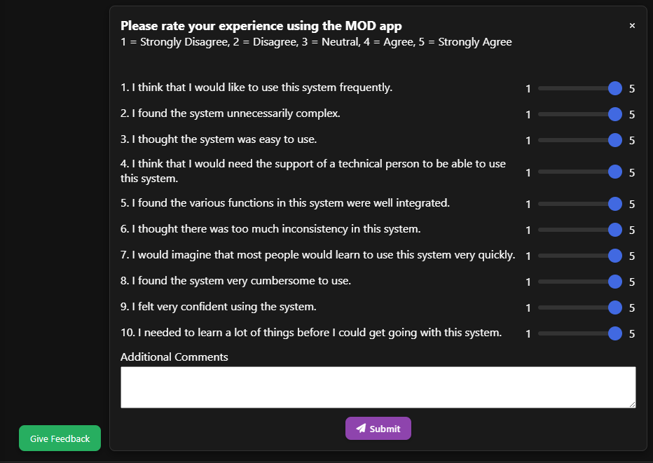

Here at 99P Labs, we are constantly exploring ways to move beyond the conventional boundaries of human-AI interaction. We believe the true potential of large language models is unlocked not just by making them more powerful, but by making them more collaborative. Today, we’re excited to share an inside look at a project we’ve been developing to tackle this very challenge. We call it Modular Output Decomposition, or MOD for short. This project started by questioning a fundamental limitation in how we work with AI today: the brittleness of its output.

This research team includes Martin Arroyo, Luka Brkljacic, Rajeev Chhajer, Ben Davis, Ryan Lingo, and Nithin Santhanam. Special thanks to Brian Coy and Tony Fontana for providing feedback on earlier drafts of this post.

## The Brittleness Problem

Today’s LLMs excel at generating fluent, coherent text. But when we push them beyond simple, single-shot tasks into complex, multi-step problem-solving, we encounter what we call the “brittleness barrier.”

Consider these common frustrations that anyone who has worked with LLMs can relate to:

- **The Email That Goes Awry:** You ask an LLM to draft an email. You like the body but want a more casual closing. When you ask for the revision, the LLM changes the closing but also “helpfully” rewrites the entire body you had already approved.
- **The Code That Crumbles:** Your AI assistant generates a Python script with several functions. You spot a small bug in a single function and ask for a fix. The LLM corrects the bug but also changes the names of other functions, breaking the parts of the script that were already working perfectly.
- **The Itinerary That Unravels:** You use an LLM to create a detailed 5-day travel plan. You decide to swap the museum visit on Day 3 with the beach trip from Day 4. When you ask for this change, the model regenerates the entire itinerary, altering the restaurant reservations and travel times you had painstakingly refined for the other days.

The root cause is that current LLM outputs are like sculptures carved from clay: beautiful, but nearly impossible to modify without starting over.

## Enter Modular Output Decomposition

What if, instead of clay sculptures, AI could build with something more like LEGO® blocks?

> LEGO® is a registered trademark of the LEGO Group. We’re simply drawing on its modular building image to explain how our system works, without any sponsorship or endorsement implied.

In our Modular Output Decomposition framework, each piece of content snaps together like a LEGO block with defined interfaces that let you swap or update one part without reshaping the whole. This approach makes it easy to lock down approved sections and rebuild only what you need.

Modular Output Decomposition (MOD) represents a fundamental shift in how we think about AI-generated output. Rather than producing monolithic blobs of text or code, we’re developing techniques to guide LLMs toward creating collections of distinct, interconnected, and independently manageable blocks.

<figure class="research-diagram research-diagram-wide">
<svg viewBox="0 0 910 365" role="img" aria-labelledby="mod-flow-title" xmlns="http://www.w3.org/2000/svg">
<title id="mod-flow-title">How MOD handles a request. The frontend sends the user's prompt and settings to the chat endpoint in the backend, which sends it to the LLM and gets a response. If the user doesn't decompose the response, the initial response is displayed. If they do, task decomposition splits it into response components. If the user keeps the components, they're assembled into the final output that is displayed, and if not, the initial response is displayed.</title>
<defs><marker id="mod-arrow" viewBox="0 0 10 10" refX="9" refY="5" markerWidth="8" markerHeight="8" orient="auto-start-reverse"><path d="M1 1 L9 5 L1 9" fill="none" stroke="currentColor" stroke-width="1.2"/></marker></defs>
<g font-size="15" font-style="italic"><text style="fill: var(--gray)" x="20" y="22">frontend</text><text style="fill: var(--gray)" x="222" y="22">backend</text></g>
<line style="stroke: var(--gray)" x1="200" y1="10" x2="200" y2="355" stroke-width="1" stroke-dasharray="2 4"/>
<g fill="none" stroke="currentColor" stroke-width="1.2" marker-end="url(#mod-arrow)">
<line x1="150" y1="114" x2="252" y2="114"/>
<line x1="320" y1="98" x2="320" y2="62" marker-start="url(#mod-arrow)"/>
<line x1="388" y1="114" x2="448" y2="114"/>
<line x1="562" y1="114" x2="640" y2="114"/>
<line x1="730" y1="132" x2="730" y2="183"/>
<line x1="730" y1="216" x2="730" y2="281"/>
<path d="M505 132 V240 H85 V280"/>
<line x1="702" y1="295" x2="162" y2="295"/>
<path d="M730 310 V345 H85 V312"/>
</g>
<g fill="currentColor" font-size="18">
<text x="20" y="120">User prompt</text>
<text x="20" y="300">Display to user</text>
<text x="320" y="50" text-anchor="middle">LLM</text>
<text x="260" y="120">Chat endpoint</text>
<text x="650" y="120">Task decomposition</text>
<text x="730" y="206" text-anchor="middle">Response components</text>
</g>
<g fill="currentColor" font-size="18" font-style="italic">
<text x="455" y="120">decompose?</text>
<text x="730" y="300" text-anchor="middle">keep?</text>
</g>
<g font-size="15">
<text style="fill: var(--gray)" x="20" y="142">and settings</text>
<text style="fill: var(--gray)" x="332" y="84">prompt and response</text>
<text style="fill: var(--gray)" x="601" y="104" text-anchor="middle">yes</text>
<text style="fill: var(--gray)" x="300" y="232">no, initial response</text>
<text style="fill: var(--gray)" x="430" y="285" text-anchor="middle">yes, final output</text>
<text style="fill: var(--gray)" x="430" y="337" text-anchor="middle">no, initial response</text>
</g>
</svg>
</figure>

The LEGO analogy runs deeper than you might think. Just as LEGO blocks follow standardized connection protocols that allow infinite recombination, we’re working toward AI outputs where each block has well-defined interfaces that enable seamless integration and substitution.

Consider the difference:

- **Clay approach:** Your AI designs a complex report as one flowing narrative. If you need to change a key statistic in the second section, you’re reshaping wet clay, where one wrong move can make the summary, conclusion, and related charts all inconsistent.
- **LEGO approach:** Each component of the report (the introduction, the data analysis section, the visualization block, the conclusion) clicks together as a distinct block. You can swap out the data analysis block with an updated version, and the other components stay perfectly aligned, ready to be re-integrated.

Think of each block of the output as a specialized LEGO block:

- **Logically Distinct:** Each block serves a specific, coherent function, just as different shapes of blocks serve different purposes in a structure.
- **Standardized Interfaces:** Just as LEGO studs and tubes follow universal connection rules, blocks have predictable inputs and outputs that allow them to connect. For example, a code block might be a function with a clear signature.
- **Endlessly Adaptable:** You can mix and match blocks across different projects, just as you can reuse blocks from one creation to build something entirely new.

## Deconstructing the Monolith: The Core Principles of MOD

This LEGO-like approach is made possible by the MOD framework, which is built upon a few key technical pillars:

- **Modular Prompting:** Instead of a single, complex prompt, the system uses distinct templates for each slice of the final output (e.g., title, summary, code).
- **Context Isolation:** Each **block** is generated with its own separate prompt, preventing the “bleed-over” of context that often corrupts monolithic outputs.
- **Structured Memory:** The system uses an external store to track the individual **blocks** and their dependencies, ensuring consistency.
- **Interface Scaffolding:** The user interface is designed with specific “slots” or containers for each block, and prompt “contracts” ensure that the outputs align with the UI’s structure.

This framework directly addresses the fragility of monolithic outputs. When a small change is needed, only the relevant block needs to be updated, not the entire artifact. Hidden errors are easier to spot because they are confined to smaller, more manageable chunks of content. Because each part stands alone, content can be easily reused or repurposed in new contexts.

To better understand the practical application of MOD, we can classify modular systems along three primary axes: Dependency Type, Artifact Nature, and Modularity Goal.

### Axis 1: Dependency Type

This axis describes the nature of the connections between blocks.

- **Narrative/Thematic:** The links are based on logical flow and subject matter. A change in one **block** suggests, but doesn’t formally require, a change in another.
  - ***Example: Email Writing.*** The Body should thematically match the Subject, but there’s no hard link. Changing the subject from “Meeting Follow-Up” to “Urgent Question” doesn’t automatically break the body, but it makes it incoherent.
- **Semantic/Factual:** The links are based on facts or definitions that must remain consistent. A change in a source block directly invalidates the dependent block.
  - ***Example: Lesson Planner.*** A Quiz Question block is factually dependent on the Core Concepts Explainer block. If you update the definition of “chlorophyll” in the explainer, the quiz question about it is now factually incorrect.
- **Functional/Syntactic:** The links are governed by a formal syntax or API contract. A change in one block creates a literal, verifiable error in another.
  - ***Example: Multi-File Code Generator.*** An HTML block’s form action is functionally dependent on a route defined in a Python backend. If you rename the route in the Python code, the HTML form is not just thematically inconsistent; it is functionally broken and will produce a 404 error.

### Axis 2: Artifact Nature

This axis describes the composition of the final product.

- **Homogeneous Artifact:** All blocks are of the same type and combine to form a single, cohesive document, like an email or lesson plan.
- **Heterogeneous Artifact:** Blocks are of different types, such as code, text, and configuration files, forming a system of interacting parts. A collection of .html, .css, and .py files that must work together is a good example.
- **Hybrid Artifact:** The output is a mix of LLM-generated content and content from external, non-LLM sources like databases or APIs.
  - ***Example: Enterprise Analytics Report.*** A Data Table block might be populated by a live SQL query, while the LLM generates an Executive Summary block that analyzes that data.

### Axis 3: Modularity Goal

This axis describes the primary user motivation for using a modular approach.

- **Refinement & Style:** The main goal is to iteratively edit and improve a creative or persuasive artifact without losing approved parts. The focus is on co-design, like when a user wants to tweak the tone of an email’s body without the LLM unexpectedly changing the greeting.
- **Consistency & Maintenance:** The focus is on ensuring long-term factual or logical correctness. The user wants to update a core concept and trust that all dependent quizzes and examples are automatically flagged for review.
- **Integration & Swappability:** The primary goal is to build a functional system where components can be independently developed, tested, and replaced. This emphasizes interoperability, such as swapping out a CSS block for a new design theme.

## Exploring New Interfaces: From Conversation to Collaboration

A core goal of our experimentation with MOD is to explore how it can improve the user interface, potentially moving AI interaction from simple conversational turn-taking to a more collaborative design experience. We hypothesize that relying solely on chat as the default interface creates an “Interface-Innovation Gap,” limiting the creation of richer, task-specific AI tools. To unlock real value, we need to design purpose-built AI interfaces.

Consider a prototype interface for a modular email writer, as envisioned by the MOD framework.

Instead of a single text area, the screen is divided into distinct zones:

- **Model Selection:** A dropdown to choose the underlying LLM.
- **User Prompt:** The initial high-level request from the user.
- **Chatbot Response:** The initial response from the LLM, as one would see in a standard interface.
- **Decomposition Trigger:** A function (like a “Decompose” button) that initiates the MOD process.
- **Block View:** This is the core of the experimental MOD interface. After decomposition, the output is broken down into logical blocks (e.g., Subject Line, Greeting, Closing).
- **Block-Level Controls:** Each block has its own set of controls, such as Lock-In, Delete, Edit, and Regenerate.
- **Final Output:** A live, assembled view of the final artifact, which updates as **blocks** are modified.

This experimental interface aims to shift how users interact with AI. The goal is to enable the user to be less of a passive prompter and more of an active director of the AI’s output. If the user likes the Subject Line but finds the Opening Line too formal, they can “lock in” the subject and click “regenerate” on only the opening. This provides the user with granular control, fostering a co-design process where human and AI work together to refine the final product.

We believe this approach offers a promising path toward a more effective “human-in-the-loop” collaboration model. The human is not just providing an initial prompt or a final correction; they are integrated into the generation process at a granular level. They can guide the AI, correct its course, and assemble the final artifact from validated, high-quality components. Our hypothesis is that this will build trust and transparency. When a part of the output is wrong, it can be treated not as a failure of the entire system, but as a localized error in a single block that can be easily addressed.

## Measuring MOD’s Usability

When we put MOD in front of real users, we need a fast, reliable way to see how they feel about it. We will use the System Usability Scale (SUS) for that check. SUS is a ten‑question survey that rolls user opinions into one score from 0 to 100, telling us in seconds whether MOD feels clunky or smooth.

**How participants answer**

- They rate each statement from **1 = Strongly Disagree** to **5 = Strongly Agree** on the screen below.
- All ten items take less than a minute to complete.

**The ten statements**

1. I think I would like to use this system frequently.
2. I found the system unnecessarily complex.
3. I thought the system was easy to use.
4. I think I would need the support of a technical person to use this system.
5. I found the various functions in this system were well integrated.
6. I thought there was too much inconsistency in this system.
7. I would imagine most people would learn to use this system very quickly.
8. I found the system very cumbersome to use.
9. I felt very confident using the system.
10. I needed to learn a lot of things before I could get going with this system.

**Scoring in three quick steps**

1. **Reverse where needed**
   - For **odd items (1, 3, 5, 7, 9)**: subtract 1 from each score.
   - For **even items (2, 4, 6, 8, 10)**: subtract each score from 5.
2. **Add them up**
   - The ten adjusted numbers now sit between 0 and 4.
   - Sum them for a total between 0 and 40.
3. **Scale to 100**
   - Multiply that total by **2.5**.
   - A score of **68** is average; **80.3+** signals excellent usability.

That single number lets us track MOD’s usability release by release and spot wins or pain points long before we roll out bigger changes.

## What’s Next for MOD?

We’re working on a few key things to make MOD better. First up is designing and developing evals, automated tests that check if MOD is doing a good job. Right now we rely on user feedback, which is great, but we need something that can test MOD’s work continuously. We’re creating evals that check if everything makes sense when pieces connect together, and if the formatting looks correct. This will help us spot problems quickly and keep improving how MOD breaks down and handles different tasks.

We’re also keeping a close eye on costs. Every time MOD generates text, it uses tokens, and tokens cost money. We think our approach might actually be more efficient than traditional methods, especially when you only need to update small parts of something instead of regenerating everything from scratch. If that’s true, it could make MOD much more practical for everyday use.

To find out if MOD really works as well as we think it does, we’re running some experiments. We’ll have people try MOD alongside a standard system and see which one they prefer and which one actually performs better on real tasks. The results will tell us whether we’re on the right track or if we need to go back to the drawing board.

## A Better Way to Collaborate: MOD in Action

The benefits of this approach become even clearer when multiple people collaborate. Imagine a team tasked with creating an enterprise analytics report: a Data Analyst, a Business Strategist, and a Marketing Writer.

With a monolithic approach, the workflow is chaotic. The Analyst generates a full draft and pastes it into a shared document. The Strategist comments that the recommendations are weak. The Writer says the tone is too dry. The Analyst must now combine this feedback into a new prompt and regenerate the entire report, hoping the new version doesn’t break the data sections that were already correct. It becomes a frustrating cycle of feedback and complete re-runs.

With MOD, the workflow is parallel and clean. The report is generated as a set of blocks: Data-Table, Analysis-Section, Strategy-Block, and Executive-Summary.

- The Data Analyst populates the Data-Table with a live query and refines the Analysis-Section. Once correct, they lock these blocks.
- Simultaneously, the Business Strategist works only on the Strategy-Block. They can regenerate it multiple times to explore different angles without ever affecting the underlying data or analysis. They then lock their approved block.
- Finally, the Marketing Writer steps in to work on the Executive-Summary. They can see the locked, final versions of the other blocks and focus solely on crafting a compelling narrative.

In this MOD workflow, team members work independently on their areas of expertise. The final document is assembled from components that have each been individually approved, eliminating the risk of one person’s edits disrupting another’s work and dramatically speeding up the collaborative process.

## Conclusion

This project represents our ongoing exploration at 99P Labs into making AI a more practical and resilient tool. By moving away from fragile, monolithic outputs and experimenting with structured, modular approaches like MOD, we believe we can create more effective interfaces and unlock truly collaborative workflows between humans and AI.

*Originally published on the [99P Labs blog](https://medium.com/99p-labs/building-resilient-ai-with-modular-output-decomposition-62b0afb84d66) on 2025-07-17.*

## See also

- [[research/index|Research]], which lists the later paper on this work, [Componentization: Decomposing Monolithic LLM Responses into Manipulable Semantic Units](https://arxiv.org/abs/2509.08203)
- [[you-are-not-using-ai-enough|You Are Not Using AI Enough]]
