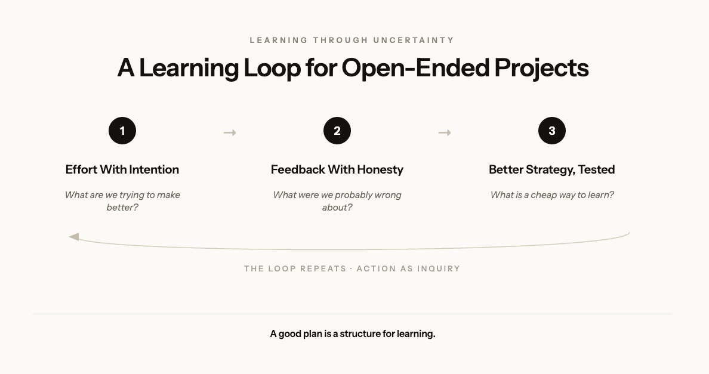
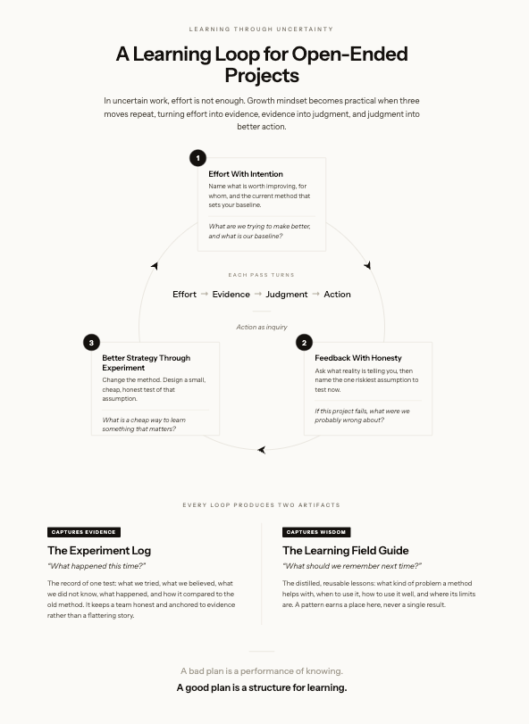

I mentor teams working on open-ended technical capstone projects. They build software, hardware, AI systems, data products, dashboards, prototypes, and tools that are supposed to work in a real context.

These projects rarely begin with a clean problem. A team might start with a prompt such as using AI to improve an experience, making sense of a messy dataset, designing a prototype for a real environment, or building a tool for a stakeholder. That kind of prompt is exciting because it feels real. It is also difficult because a team does not only have to solve a problem. It has to figure out what a problem is.

In that kind of work, effort matters. But effort is not enough. A team can work hard and still chase a weak problem. It can write more code before validating a workflow. It can tune a model before asking whether a metric matters. It can build a polished prototype before testing a risky assumption.

This is where growth mindset is often misunderstood. Growth mindset is not just praising effort. Effort becomes useful when it is connected to feedback and better strategies. A useful version of growth mindset has three parts. Work hard. Seek feedback. Try a better strategy. That is a simple loop, but it is powerful. In open-ended projects, the loop needs to become explicit. Teams need a way to turn effort into evidence, evidence into judgment, and judgment into better action.

That is where planning comes in. By the end of this piece, I will share the two artifacts I ask teams to keep, an Experiment Log and a Learning Field Guide.

## A Problem With Planning

My view is not that planning is useless. It is that planning is usually asked to do more than it can do. Many plans assume important things are already known, such as a goal, a terrain, a causal path, a set of risks, and a set of costs. But in many projects that matter, those things are not known yet. They have to be learned through action.

So a danger is not planning itself. A danger is epistemic arrogance, which means acting as if we know more than we actually know. Epistemic arrogance turns guesses into commitments too early. It creates a beautiful story about a future before a team has had enough contact with reality to know whether that story is true.

I watch versions of this every semester.

A data team building a driving-behavior dashboard spends weeks refining charts, colors, and filters. When someone finally asks which decision the dashboard should support, no one has an answer. The polish was effort. It was not progress.

An AI team keeps tuning a complex model to raise a benchmark score. When the team finally compares it against a simple baseline, the baseline nearly matches it. Weeks of tuning had been testing patience, not the idea.

A hardware team demos a sensor that works beautifully on a desk. Outside, in vibration, heat, and glare, it fails within minutes. The demo had answered a question nobody was asking.

In each case, the team was working hard inside a plan. The plan just was not built to catch what the team did not know.

A bad plan says here is what will happen. A good plan says here is what we believe, here is what we do not know, here is a cheap way to learn, and here is what would make us change course. A good plan makes ignorance visible. It helps a team notice when it is wrong sooner, cheaper, and with less damage. In uncertain work, progress can mean learning. It can mean reducing confusion, discovering what works, what breaks, what matters, and what was only attractive from a distance.

## A Plan Should Also Test Desire

There is a deeper problem too. Plans often assume desire is fixed. They begin with “what do we want?” as if an answer is obvious. But often we do not yet know what is worth wanting. Sometimes goals are borrowed from trends, rivals, or status games. A team can become very organized in pursuit of something it should have questioned earlier.

This matters in capstone work because technical teams move quickly toward building. A new tool, model, or hardware concept can become attractive just because it is possible. But possibility is not purpose. A good plan tests more than feasibility. It asks not only whether we can build this, but whether we should still want this after we understand its cost. It asks not only whether a model can perform well, but whether that performance matters in a real decision.

A plan is useful when it coordinates action, reduces downside, or accelerates learning. It is wasteful when it creates an appearance of control. A better plan treats action as inquiry.

## A Learning Loop for Open-Ended Projects

The loop comes from the three moves of growth mindset. Effort, feedback, and better strategy. In open-ended projects, each move needs sharper questions.

### 1. Effort With Intention

Effort is useful when a team knows what it is in service of. Before debating features, models, or sensors, a team should ask what it is trying to make better, for whom, and why it matters.

A useful intention is not a polished mission statement. It is a working claim about what is worth improving. For example, we are trying to help drivers understand when an automated system is uncertain. We are trying to reduce a user’s time in a frustrating workflow. We are trying to make sensor data easier to interpret in a field setting. An intention may change as a team learns. That is not failure.

The team should also name its current method. It might be building more features, tuning a model, cleaning more data, or meeting more often because it feels stuck. This creates a baseline. Without a baseline, a team cannot know whether a new strategy works better.

### 2. Feedback With Honesty

Feedback turns effort into information. Without it, teams repeat themselves. They may feel productive, but they are not learning. A team should ask what reality is telling it, including what users said, what users actually did, where a prototype failed, where a model made errors, and what feedback the team is avoiding because it threatens an idea it likes.

The next step is to name assumptions. Every project rests on them, and teams often build on assumptions without naming them. A sharp question cuts through. If this project fails, what were we probably wrong about? That answer points to a riskiest assumption. For an AI project, it might be that a model output is trustworthy enough for a use case. For a hardware project, it might be that a sensor works reliably outside a demo. For a software project, it might be that users will change their workflow to use a tool. A team should not test everything at once. It should test an assumption that matters most right now.

### 3. Better Strategy Through Experiment

Effort and feedback are not enough if a team does not change its method. If a team is stuck building features, a better strategy may be usability testing. If it is stuck tuning a model, a better strategy may be error analysis or a baseline comparison. If it is stuck in discussion, a better strategy may be a decision log. Teams develop judgment here. They learn which methods fit which kinds of uncertainty.

A good plan does not ask a team to prove everything at once. It asks for a cheap way to learn something important. That question changes vague activity into a useful test. Not “we will do more research,” but “we will interview three users to see whether this problem appears in their real workflow.” Not “we will improve the model,” but “we will compare it against a simple baseline to see whether added complexity is worth it.”

A useful test is small, clear, and honest. A philosophical question helps. What would we expect to see if our idea is wrong?

## An Experiment Log Keeps a Team Honest

After a test, a team records what happened in an Experiment Log. A log should answer a few questions.

- What were we trying to do?
- What did we believe, and what did we not know?
- What assumption did we test, and with what strategy?
- What happened?
- How did this compare to our old method?
- What did we learn, and what stayed unclear?

A log does not need to be long. Its job is to keep a team honest. Teams often turn memory into a story that protects an idea they already liked. A log keeps attention on evidence. A working demo is not a validated solution. A higher metric is not real value by itself. A polished interface is not a better experience by itself.

After each entry, a team decides what to do next. It might keep going, adjust an idea, change a method, test a different assumption, or reconsider what it wanted in the first place. A team is not obeying an original plan for its own sake. It is using a plan to learn, and then updating the plan because it learned. That is not a failure of planning. That is what planning is for.

## From Experiment Log to Learning Field Guide

An Experiment Log captures what happened. Teams also need a second artifact, a Learning Field Guide, which is a collection of reusable lessons. It is not a bag of tricks. It is what a team has learned about how to learn. A log asks what happened this time. A field guide asks what we should remember for next time. A single experiment creates evidence. A pattern creates a field guide entry.

An entry might sound like this.

- When we are excited about a solution too early, assumption testing helps us find a risky belief.
- When an AI system looks impressive, a simple baseline helps us test whether complexity is useful.
- When a dashboard feels polished but vague, decision mapping helps connect data to action.
- When hardware works in a demo, constraint testing helps us learn whether it can work in context.
- When meetings create discussion but not decisions, a written decision log helps.

These are not universal laws. They are tested lessons with context. A useful entry says what kind of problem it helps with, when to use it, how to use it well, what evidence shows it works, and where its limits are.

A log captures evidence. A field guide captures wisdom.

## A Note on Influences

This way of thinking builds on several traditions. Carol Dweck’s work on growth mindset clarifies that improvement is not just about effort. People also need feedback, better strategies, and support from others. Improvement methods like PDSA and PDCA, developed by Walter Shewhart and W. Edwards Deming, show how progress comes from small tests of change. Try something, study what happens, and adjust. David Kolb’s experiential learning and Donald Schön’s reflective practice treat experience as raw material. People improve when they reflect on what happened, draw a lesson from it, and test that lesson in another situation. Design thinking adds a warning for open-ended work. Understand people, test assumptions, prototype early, and learn before committing to a solution.

Technical work adds one more requirement. Teams must test not only whether something is desirable, but whether it is feasible, reliable, ethical, and valuable in context.

My contribution here is a simple distinction. A log captures evidence, and a field guide captures reusable lessons. That distinction helps teams avoid two common mistakes. The first is treating one attempt as proof. The second is collecting generic methods that have never been tested against a real problem.

## A Takeaway

Open-ended technical projects do not just require effort. They require a way to learn through uncertainty. That is a deeper version of growth mindset. Not just try harder. Instead, try with intention, seek feedback, change strategy, test assumptions, record what happens, and learn what is worth reusing.

Planning still matters, but not because a plan predicts a future. A good plan says here is what we are trying to do, here is what we believe, here is what we do not know, here is a cheap useful test, and here is what would make us change course. That kind of plan does not pretend to know too much. It does not treat deviation as failure. It treats action as inquiry.

**A bad plan is a performance of knowing.**

**A good plan is a structure for learning.**

*Originally published on the [99P Labs blog](https://medium.com/99p-labs/learning-through-uncertainty-d4493628f4ad) on 2026-07-08.*

## See also

- [[what-do-we-mean-by-learning|What Do We Mean by Learning?]]
- [[you-are-not-using-ai-enough|You Are Not Using AI Enough]]
