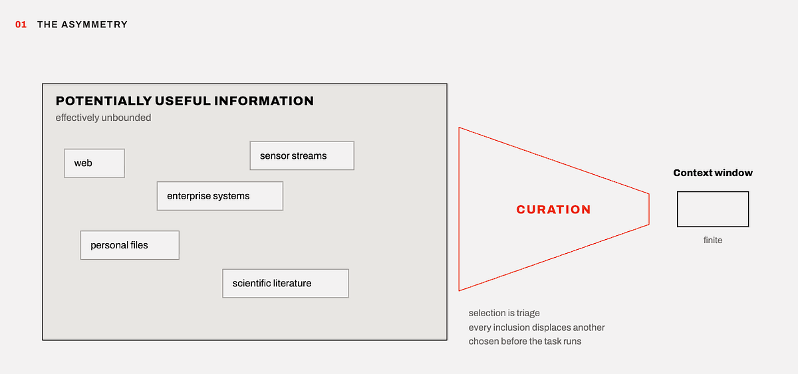
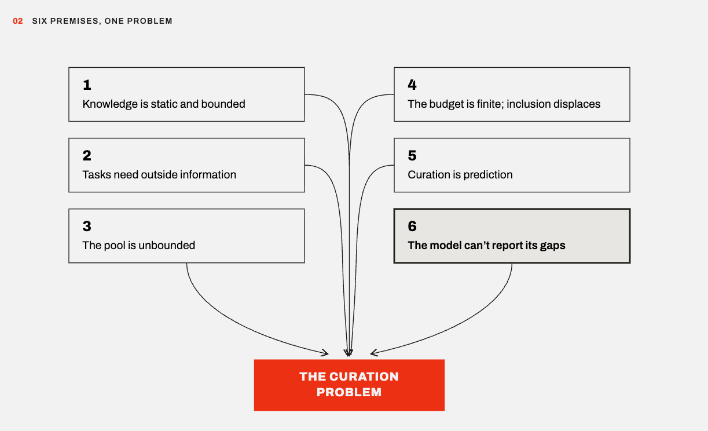
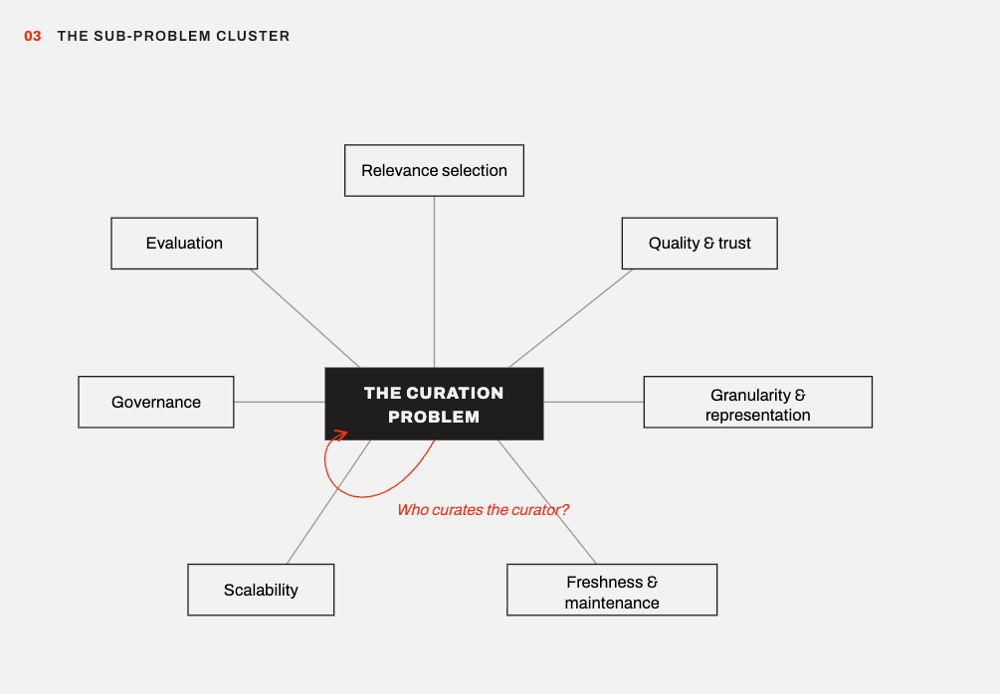
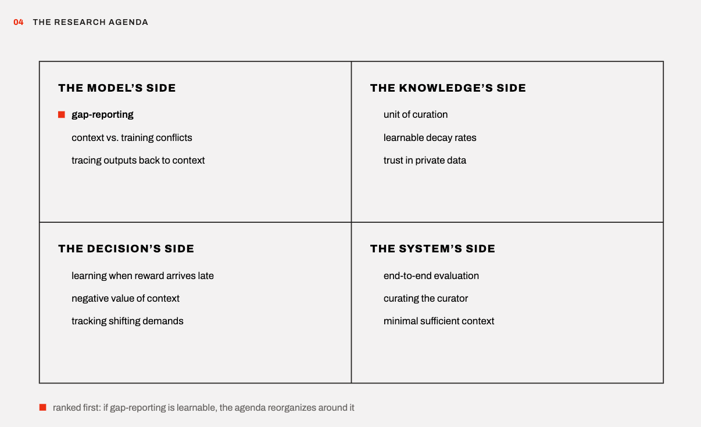
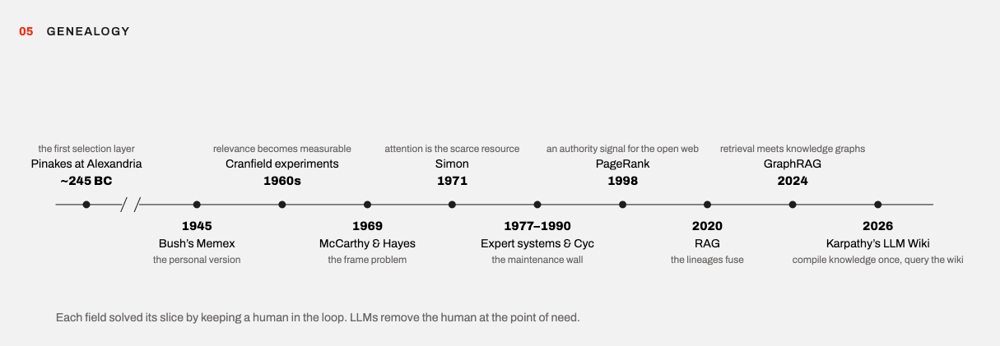
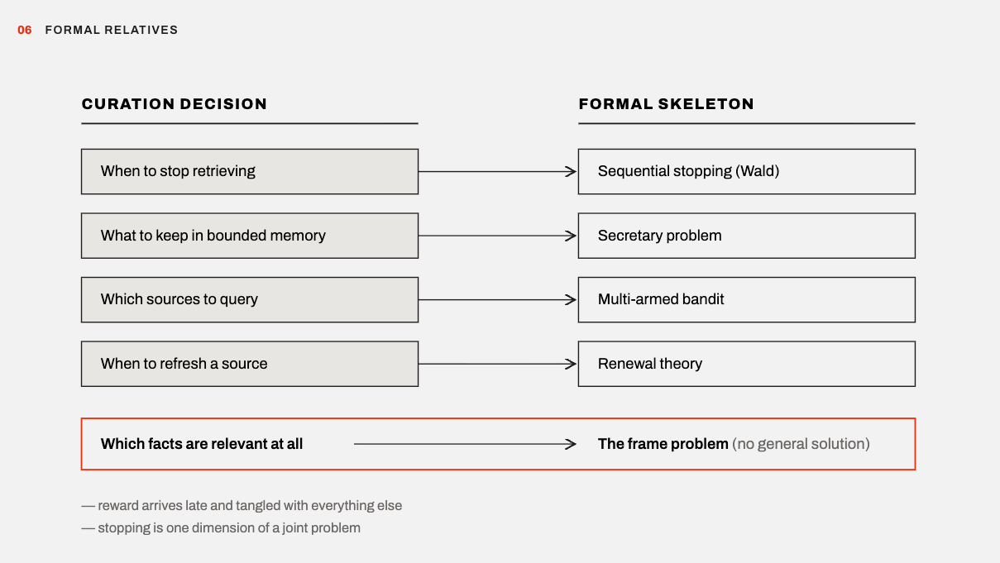

Language models know a great deal, but what they know is fixed at training time, while the tasks we give them live in a changing world. Bridging that gap has produced a wave of techniques, retrieval augmentation, agentic search, memory systems, long context windows. In this post we argue that these techniques share a single underlying problem that deserves to be studied directly. We call it the Curation Problem, the cluster of questions involved in deciding what information a model should see, in what form, and how that information stays current. We lay out the problem from first principles, trace its long history, and propose a seed for a research agenda. We present this as a set of working hypotheses rather than settled conclusions, and we expect parts of it to be wrong in instructive ways.

## The problem from first principles

Six premises generate the problem. Each is a hypothesis we currently believe, and the rest of the post follows if they hold.

**1\. A model's knowledge is static and bounded.** It is a compressed snapshot of training data at a fixed cutoff. The snapshot is incomplete because the world is larger than any dataset, and it decays because the world changes.

**2\. Useful work often requires information outside the snapshot.** Current events, private data, proprietary knowledge, the state of the specific task at hand. Without that information, the model must guess, and systematic guessing is one root of hallucination.

**3\. The pool of potentially useful information is effectively unbounded.** The web, enterprise systems, personal files, sensor streams, the scientific literature, plus every filtering and synthesis of all of it.

**4\. The budget is finite, and every inclusion displaces something else.** Context windows, attention, latency, and cost are all bounded. Curation is therefore triage rather than selection from abundance. Herbert Simon made the underlying observation decades before context windows existed. A wealth of information creates a poverty of attention, so an information system must be judged by what it excludes (Simon, 1971).

**5\. Curation is prediction.** Information is chosen before the task runs, for future questions the system can only estimate. Relevance cannot be measured at decision time. It can only be bet on.

**6\. The model cannot reliably tell you what it needs.** Current models have little reliable awareness of their own knowledge gaps. They rarely signal "I lack this specific input." As a result, an outside party makes every curation decision without access to the model's internal state. We are building external memories for systems that cannot report what they are missing.

From these premises, the Curation Problem emerges as a cluster of interdependent sub-problems. Relevance selection, quality and trust filtering, granularity and representation, freshness and maintenance, scalability, governance, and evaluation. There is also a recursive version. Any automated curator, a retriever, a ranker, a summarizer, carries its own fixed assumptions that also drift. Automating curation moves the problem up a level rather than dissolving it.

## A research agenda

If the premises hold, they generate open problems. We group them into four clusters, and for each question we try to say what exists today, why it falls short, and what a meaningful result would look like.

## The model's side

**Can a model learn to report its own gaps?** We consider this the central question, because premise six is the load-bearing one. If models could reliably signal "I need X to answer this," much of the Curation Problem would shrink to simply fetching what the model asks for. Calibration research shows that models can express uncertainty about their answers, but uncertainty about an answer is not the same as identifying the missing input that would resolve it. Today's agent systems approximate gap-reporting with generic search rules, which is one reason they retrieve too much. A meaningful result would be a training objective whose output is a verifiable information request, scored on whether fulfilling the request improved the task rather than on whether the request sounded plausible. A negative result would also be valuable, because it would establish that curation must remain external, which changes what should be built.

**How do models choose between context and weights?** Information placed in a model's context is treated as trustworthy, but the model also holds beliefs learned in training, and the two can conflict. We understand little about when context wins, when training wins, and what determines the outcome. The question matters because a costly failure mode lives exactly here. Outdated information injected with confidence produces confident wrongness, which is worse than absence, since absence at least produces hedging. A meaningful result would be a predictive account of how models resolve these conflicts, and eventually a way to control it.

**Can output claims be traced back to context?** When an answer is wrong, which retrieved piece caused it? Diagnosis today works by removing pieces of context and rerunning, which is expensive and coarse. Methods that trace specific output claims to specific spans of context would turn curation debugging from folklore into measurement, and would supply curation systems with a training signal they currently lack.

## The knowledge's side

**What is the right unit of curation?** Documents, chunks, facts, and embeddings each lose something. Splitting documents into chunks strips away qualifiers, and a fact separated from its scope can reverse its meaning. Embeddings lose track of where information came from. Knowledge graphs preserve structure but resist the messiness of real text. Is there a representation that keeps qualifiers attached, carries its source and its shelf life with it, and remains cheap to update? We suspect the graph tradition and the vector tradition each hold part of the answer, and that the synthesis is unclaimed territory.

**Can decay rates be learned?** Freshness policy today is typically a manually set expiration date, the same tool caches used decades ago. Yet facts have empirical half-lives. A capital city and a stock price go stale at very different rates, and those rates are visible in historical revision data. Systems that learn per-item decay and build the risk of staleness directly into retrieval scores would convert freshness from a policy someone forgets to set into a learned property of the knowledge itself.

**Is there a trust signal for private data?** PageRank solved authority for the open web by mining the link structure for implicit endorsement (Brin & Page, 1998). Enterprise and personal data have no comparable structure, yet they are precisely where these systems are being deployed. What plays the role of implicit endorsement inside a private collection? Internal citation patterns, edit and access histories, and organizational structure are candidates, but to our knowledge no signal has been shown to generalize.

## The decision's side

**Can curation policies be learned when the reward arrives late?** The classic mathematical tools, which we describe below, assume an item can be scored the moment it is seen. Curation cannot do this. Whether a document helped becomes known only after the task completes, if ever, and the signal is entangled with everything else in context. This is a reinforcement learning problem where it is unusually hard to tell which choice deserves the credit or the blame, and we have not seen it posed cleanly. A benchmark that isolates it would be a contribution on its own.

**What is the negative value of context?** The field measures what added information contributes and rarely measures what it displaces or dilutes. There is growing evidence that irrelevant context degrades output, which implies that adding a token can have negative value. A principled account of the marginal value of each token, and retrieval systems that optimize for it rather than for similarity scores that ignore displacement, would address one of the quieter failure modes in deployed systems.

**How should curation track shifting demands?** Premise five says curation is a bet on future questions, but the questions themselves drift. A curation layer tuned to last quarter's questions quietly misallocates its budget against this quarter's. Shifting distributions are well studied in learning theory and, as far as we can tell, almost unstudied as a curation problem. What does it mean for a knowledge layer to track moving demands, and how does one detect that curation has gone stale even when every individual fact remains true?

## The system's side

**How should curation be evaluated end to end?** Retrieval metrics score the bet, not the outcome. Recall can climb while task performance stalls, because the easy-to-measure proxy was optimized instead of the goal. Benchmark designs that isolate curation quality from model quality, so that two curation layers can be compared while holding the model constant, are a prerequisite for the field knowing whether its methods are improving at all.

**Who curates the curator?** Automated curation systems drift, and self-maintained knowledge bases risk compounding their own errors into the record. What does a maintenance theory for the curation layer itself look like? Can it audit itself without infinite regress, or is a human audit layer unavoidable? The answer bears on whether fully autonomous knowledge systems are achievable, or whether curation has a permanent human floor.

**Is there a notion of minimal sufficient context?** Information theory suggests a target. For a given task and model, there should be a smallest context that achieves maximal performance, with everything beyond it waste and everything short of it a gap. No one can compute it, but even loose bounds could discipline the field, somewhat as channel capacity disciplined communication engineering without ever being achieved in practice. We hold this analogy loosely, but a formal notion of context sufficiency seems to us the missing theoretical object.

Of these twelve questions, we rank the first well above the rest. If gap-reporting is learnable, the cluster reorganizes around it. If it is not, the remainder of the agenda is what the field is left with.

## The problem is old

The Curation Problem did not begin with language models. It is the collision of several older problems, each partially solved in its own field. The lineage is worth knowing because it identifies which lessons have already been paid for.

Library science met the problem first. The Library of Alexandria held more scrolls than any person could read, so Callimachus built the Pinakes, a catalog, in the third century BC (Blum, 1991). When the pool exceeds the reader, a selection layer gets built. Librarians also learned early that a collection is a garden rather than a pile, and that weeding is part of the job.

Vannevar Bush framed the personal version in 1945. Human knowledge was outgrowing the tools for consulting it, so he imagined the Memex, a personal machine of associative trails through one's own documents (Bush, 1945). Modern AI memory systems are its descendants.

Information retrieval made relevance measurable. The Cranfield experiments of the 1960s produced precision and recall, and with them the field's central admission. Relevance is not a property of documents. It is a relation between a document and a need, and the need is only ever partially expressed (Cleverdon, 1967).

Symbolic AI hit the maintenance wall. Expert systems ran on hand-curated knowledge, and the field named its own limiting factor, the knowledge acquisition bottleneck (Feigenbaum, 1977). The Cyc project set out in 1984 to hand-curate common sense itself, and became a decades-long demonstration that curation cost grows without bound (Lenat & Guha, 1990). The lesson is among the hardest in the cluster. Curation is not a setup task. It is a permanent one.

Philosophy of AI identified the deep core. The frame problem asks how a reasoner knows which facts are relevant to update when something changes, without checking every fact it holds (McCarthy & Hayes, 1969). Dennett later argued that this relevance-determination problem is the central puzzle of cognition rather than a technical wrinkle (Dennett, 1984). No general solution is known.

Database systems contributed the freshness machinery. View maintenance, cache invalidation, and ETL pipelines are the engineering tradition of keeping a derived copy of the world consistent with the world. The old joke that cache invalidation is one of the two hard problems in computer science reflects how difficult this sub-problem was already known to be.

Web search solved trust at scale, once. PageRank answered the authority question for the open web by mining link structure for implicit endorsement (Brin & Page, 1998). It worked because the web carries its own trust signal. Private data carries none, so the trust problem reopens.

The current era fused these lineages. Retrieval-augmented generation attached the information retrieval tradition to the pretrained model (Lewis et al., 2020). Long context windows raised the budget without changing the underlying asymmetry. Memory systems revived the Memex. Each is a partial repayment of one branch of the inherited debt.

The genealogy suggests a conjecture worth stating plainly. Each ancestor field managed its slice of the problem by keeping a human in the loop at the point of need. The librarian, the knowledge engineer, the searcher refining her own query. Current systems often remove that human at exactly the point of need, because the model consumes the information directly and cannot yet ask good questions about what it lacks. Our guess is that this removal is what makes an old problem newly hard.

## The problem has formal relatives

Parts of the cluster have clean mathematical skeletons, and they are worth knowing because they arrive with solved theory.

Deciding when to stop retrieving and start generating is a sequential stopping problem. Each additional search costs tokens and latency and might surface something valuable, so one stops when the expected value of the next look drops below its cost. That structure is Wald's sequential analysis (Wald, 1947). Deciding which items to keep in bounded memory as they stream past, one at a time and often irrevocably, has the shape of the secretary problem (Ferguson, 1989). Deciding which sources to query, when source quality must be learned by trying them, is a multi-armed bandit. Deciding when to refresh a decaying source is a renewal problem from the maintenance literature.

The mapping breaks in two informative places. First, the reward arrives late and tangled with everything else, which is the learnability question raised above. In the secretary problem a candidate can be ranked on sight. In curation, whether a document helped becomes known only after the task completes, if ever. Second, stopping is one dimension of a joint problem. Optimal stopping says when to quit looking and nothing about representation, trust, or governance. The tractable relatives each capture one sub-problem. The intractable relative, the frame problem, captures the center.

## Why this matters in practice

Our hypothesis is that a substantial share of the production problems in deployed language model systems are related to curation rather than to the model itself. We cannot prove the share, but many familiar failures fit the pattern.

A retriever returns plausible but useless context, and output gets worse than if nothing had been added, because attention was diluted. A stale document enters context and is repeated with confidence, because context arrives pre-trusted. A fact is separated from its qualifier and its meaning reverses. A knowledge base degrades silently until users stop trusting the system, and no one can name when it happened. A poisoned source carries instructions rather than information, and the pipeline delivers the attack into the model's trusted channel. A team optimizes retrieval recall while task performance stalls, because the proxy was measured instead of the goal.

Each of these looks to us like a curation failure. Teams tend to treat them as isolated bugs and patch them one at a time. If the framing here is right, naming the cluster changes how systems get built. The question shifts from which vector database to what the theory is of what this model needs to see, how that theory is validated, and who maintains it. Curation becomes a designed system with an owner, a budget, and failure modes to test against, rather than a side effect of a retrieval library's defaults.

The economic implication follows directly. Model capabilities are converging, and as they do, the durable advantage of an applied AI product lives in its curation layer. What it knows about the user and domain, how fresh that knowledge is, and how well it predicts what each task needs. Models can be swapped. Curation compounds. The frozen brains are rented; the knowledge layer is owned, and we believe it is where the lasting value of applied AI will be built.

## Closing thoughts

The frame problem suggests that the general version of relevance determination may have no solution. If so, that is not cause for pessimism. It is a scoping instruction. The research program is to find which restricted versions of the Curation Problem are tractable, solve those, and be honest about what remains. The field has spent several years perfecting the plumbing. Our bet is that the water is now the problem.

*Originally published on the [99P Labs blog](https://medium.com/99p-labs/the-curation-problem-d564306b3163) on 2026-07-22.*

## See also

- [[why-we-have-the-data|Why 'We Have the Data' Is Never the Same as 'We Know What to Do']]
- [[you-are-not-using-ai-enough|You Are Not Using AI Enough]]

## References

Blum, R. (1991). *Kallimachos: The Alexandrian Library and the Origins of Bibliography.* University of Wisconsin Press.

Brin, S., & Page, L. (1998). The anatomy of a large-scale hypertextual Web search engine. *Computer Networks and ISDN Systems*, 30(1–7), 107–117.

Bush, V. (1945). As we may think. *The Atlantic Monthly*, July 1945.

Cleverdon, C. (1967). The Cranfield tests on index language devices. *Aslib Proceedings*, 19(6), 173–194.

Dennett, D. (1984). Cognitive wheels: The frame problem of AI. In C. Hookway (Ed.), *Minds, Machines and Evolution.* Cambridge University Press.

Feigenbaum, E. A. (1977). The art of artificial intelligence: Themes and case studies of knowledge engineering. *Proceedings of IJCAI-77*, 1014–1029.

Ferguson, T. S. (1989). Who solved the secretary problem? *Statistical Science*, 4(3), 282–289.

Lenat, D. B., & Guha, R. V. (1990). *Building Large Knowledge-Based Systems: Representation and Inference in the Cyc Project.* Addison-Wesley.

Lewis, P., et al. (2020). Retrieval-augmented generation for knowledge-intensive NLP tasks. *Advances in Neural Information Processing Systems*, 33.

McCarthy, J., & Hayes, P. J. (1969). Some philosophical problems from the standpoint of artificial intelligence. In B. Meltzer & D. Michie (Eds.), *Machine Intelligence 4.* Edinburgh University Press.

Simon, H. A. (1971). Designing organizations for an information-rich world. In M. Greenberger (Ed.), *Computers, Communications, and the Public Interest.* Johns Hopkins Press.

Wald, A. (1947). *Sequential Analysis.* Wiley.
