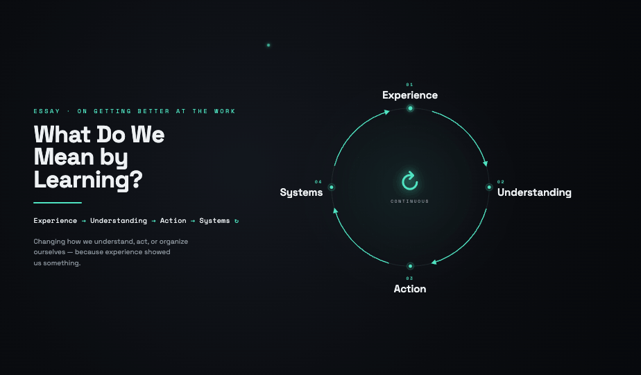

Many people say they value learning.

They say failure is fine as long as they learn from it. They say teams should learn faster. They say organizations need a learning culture. But the more I hear the word, the less sure I am that we mean one thing by it.

Part of the problem is that learning feels like a simple word. It sounds obvious. Everyone can use it. Nobody has to stop and define it.

But simple words can hide complicated ideas.

The philosopher Ludwig Wittgenstein spent a lot of time thinking about this kind of problem. One of his useful points was that words do not get their meaning from definitions alone. They get their meaning from use. To understand what a word means, look at what people are doing with it.

That matters here because people use the word learning to do different jobs.

Sometimes they use it to mean understanding why something happened. Sometimes they use it to mean changing a behavior. Sometimes they use it to mean running an experiment. Sometimes they use it to mean writing down a lesson so someone else can use it later.

Wittgenstein also had an idea called family resemblance. The basic point is that some concepts do not have one feature shared by every example. Instead, the examples overlap. They resemble one another the way members of a family might: one shares the eyes, another the posture, another the expression, but no single trait belongs to everyone.

Learning seems like that kind of concept.

The different things we call learning are related. They overlap. But they may not all share one clean essence. That makes learning a useful abstraction, but also a risky one. It gathers many different kinds of work under one name.

That is what abstractions are for. They let us see a pattern without naming every case. But they also hide detail. They can make unlike things look more alike than they are.

This matters because people can agree at the level of the abstraction while disagreeing about what should happen next. A team can say “we need to learn from this” and still mean different things in practice. One person wants root cause. Another wants customer insight. Another wants a clearer goal. Another wants an experiment. Another wants a process change.

Nobody has to be wrong for the conversation to get stuck. The abstraction is too broad to guide action by itself.

This piece is my attempt to make the abstraction useful again by breaking it apart.

Not for school. Not for facts on their own. I mean the everyday kind of learning: how a person, team, or organization gets better at the work in front of them.

**Here is the working definition I use:**

> Learning is the practice of changing how we understand, act, or organize ourselves because experience showed us something.

That definition matters because it gives us one way to ask whether learning happened.

In practice, I look for learning by asking what is now different.

Different understanding. Different action. Different systems. Or a different way of learning next time.

If nothing changed, learning did not happen. Motion happened. And motion can feel a lot like learning from the inside.

The change can show up in four places:

- **Understanding**: what we believe about how things work.
- **Action**: what we actually do.
- **Systems**: the tools, rules, routines, and defaults that shape what people do.
- **Future learning**: how well and how fast we learn next time.

Useful learning usually moves at least one of these.

The hard part is often knowing which one needs to move.

## The loop

The four results feed each other.

Experience improves understanding. Understanding sharpens action. Better action builds better systems. Better systems make the next round of learning easier.

When the loop turns, progress can compound. Each pass leaves you better set up than the last.

When the loop breaks, work can run in place and call itself progress.

The loop can break in different ways. Each break may call for a different kind of learning. I see eight.

## The eight kinds at a glance

| Kind | When it applies | The question it answers |
| --- | --- | --- |
| Diagnostic | Something is happening, but the cause is unclear | Why is this happening? |
| Discovery | The right thing to care about is unclear | What matters? |
| Framing | The goal needs to become specific | What exactly do we want to change? |
| Generative | The current options are not enough | What could exist that does not yet? |
| Improvement | The goal is clear and the result should get better | Does this change work? |
| Adaptive | The situation has changed | What still holds, and what no longer holds? |
| Meta | The way you learn could be better | How do we learn better? |
| Institutional | A lesson needs to last beyond one person | How does this become how we work? |

The rest of this piece walks through each one: what it is, when to use it, and what can go wrong when you skip it.

### Diagnostic: understand what is happening

Diagnostic learning is figuring out what is actually going on.

Use it when you can see the problem, but you do not yet know the cause.

> Defects jumped last month.

The question it answers: **why is this happening?**

The instinct is often to jump straight to a fix. That instinct can be the trap.

First, understand the system. Where does the problem enter the process? What changed right before it? Is this a real shift or normal variation? Is the cause built into the process, or did one specific event create it? Which part is actually breaking?

Skip diagnostic learning and you may fix the wrong thing with confidence. The symptom may go quiet for a while, but the real cause can stay. Later, it may come back wearing a new face.

### Discovery: understand what matters

Discovery learning is figuring out what matters in the first place.

Use it before you have a clear target, when you are not even sure you are looking at the right thing.

> People seem unhappy with the product, and nobody can say what “better” would mean to them.

The question it answers: **what should we care about?**

Reach for discovery when the problem is vague, the customer’s real need is unclear, or the current measure of success may be misleading.

This is the kind of learning that can stop you from getting very good at something that does not matter.

### Framing: make the goal specific

Framing learning turns “what matters” into a clear target.

Discovery points at the right area. Framing draws the lines inside it.

> Cut cycle time from 10 days to 5.

> Stop the same defects from returning in each release.

> Make onboarding faster without lowering quality.

The question it answers: **what exactly do we want to change?**

Framing forces the choices people like to avoid. What outcome counts? How will we measure it? What is in scope? What is out? What tradeoff can we accept? What must not get worse?

A bad frame can distort everything after it. The experiments can run well and still waste effort if they aim at the wrong thing.

### Generative: create new options

Generative learning creates options that do not exist yet.

It is not fixing, tuning, or diagnosing. It is making.

> What would make this problem disappear instead of shrink?

> What would a much simpler version look like?

> What new capability would change the game?

The question it answers: **what could exist that does not exist now?**

The danger it guards against is narrowness.

It is tempting to polish the current way of working because polishing feels productive. Generative learning creates the space to ask whether a different system should exist at all.

Without it, you can end up becoming very efficient at the wrong thing.

### Improvement: test whether a change works

Improvement learning tests whether a change actually works.

This is the classic kind of learning. It is what many people picture when they hear the word. Use it when the goal is clear and you want the result to improve.

> Cut cycle time from 10 days to 5.

The question it answers: **does this change work?**

This is where you are trying to understand cause and effect. Make a change, compare before and after, and let the evidence decide.

Improvement learning works best when the problem is understood, the direction is clear, the measure is honest, and the work is stable enough to test against.

The common mistake is starting here too soon. Before you know the cause, you may need diagnostic learning. Before you know the goal is right, you may need discovery and framing.

A clean experiment on the wrong question may teach you less than it seems.

### Adaptive: update your assumptions

Adaptive learning updates your assumptions when the situation changes underneath you.

Something that used to work stops working, not because you did it wrong, but because the world moved.

> The process worked at 20 customers and breaks at 2,000.

> A regulation changed.

> A new tool reshaped the work.

> Customers want something different now.

The question it answers: **what still holds, and what no longer holds?**

Adaptive learning can look like improvement learning, but the situation is different.

In improvement learning, the goal is steady and the system is known. In adaptive learning, the situation itself is moving. Your old assumptions are the thing under review.

Treat a changing world like a stable one and optimization can start to become a risk.

### Meta: get better at learning

Meta-learning is learning about learning.

It asks whether the way you learn is itself improving.

Are experiments too big to learn from quickly? Are reviews producing real changes? Does anyone capture what gets learned? Do lessons live in one person’s head? Do the same mistakes keep returning? Do standards actually change after the lesson?

The question it answers: **how do we learn better?**

This is a layer many teams skip.

A team can run many improvement cycles without getting much better at running improvement cycles. A team can hold many retrospectives and still have the same conversation every month.

Meta-learning turns the lens back on the learning process itself.

### Institutional: make the lesson last

Institutional learning makes a lesson outlive the person who learned it.

One person can grow while the organization around them changes very little. A lesson starts to become organizational when it changes something shared: a standard, checklist, training, design rule, decision rule, playbook, metric, onboarding path, tool, routine, or cultural norm.

The question it answers: **how does this become how we work?**

Here is one test.

If the lesson walks out the door when one person leaves, the organization may not have learned as an organization. If the same problem comes back every quarter, the lesson may not have become part of how the organization works.

It may have only watched an individual learn.

## How the eight fit together

Most real work moves through six kinds of learning in a rough order. The other two wrap around the whole thing.

Diagnostic, discovery, framing, generative, improvement, and adaptive are often part of the work itself. Meta-learning improves how all six are done. Institutional learning helps lock in what was learned so it can last.

| Scope | Learning type | The question |
| --- | --- | --- |
| Problem definition | Discovery | What matters? |
| | Framing | What exactly do we change? |
| Investigation | Diagnostic | Why is this happening? |
| Solution design | Generative | What could exist? |
| | Improvement | Does this change work? |
| Context shift | Adaptive | What no longer holds? |
| System wrapper | Meta | How do we learn better? |
| | Institutional | How does this become how we work? |

This is not a strict pipeline. Real work moves back and forth, and it should.

A failed experiment can reveal a misread cause, sending you back to diagnostic. A measure can improve while the experience gets worse, sending you back to discovery. A process can work in one context and break in another, creating adaptive work. A strong lesson can still vanish if it never changes a standard, tool, or routine.

I do not think there is a fixed order to obey.

There is one question I find useful to keep asking:

> What kind of learning do we need next?

## Where it breaks

When work fails to get better, one possible cause is a missing kind of learning.

| The symptom | The missing layer |
| --- | --- |
| Improving a measure before knowing if it matters | Discovery |
| Proposing fixes before understanding the cause | Diagnostic |
| Testing hard against a vague goal | Framing |
| Polishing the old system instead of imagining a better one | Generative |
| Treating a changing world like a stable process | Adaptive |
| Running many experiments but not getting better at experimenting | Meta |
| Watching the same lessons vanish or repeat every quarter | Institutional |

## How to use it

Use this as a diagnostic question for the work itself.

When the work stalls, do not start with a status update. Ask:

> What kind of learning do we need right now?

Then match the need to the kind.

- Need the cause? Use diagnostic learning.
- Need to know what matters? Use discovery learning.
- Need to make the goal specific? Use framing learning.
- Need new options? Use generative learning.
- Need to test a change? Use improvement learning.
- Need to respond to a changed situation? Use adaptive learning.
- Need to improve how you learn? Use meta-learning.
- Need the lesson to last? Use institutional learning.

It sounds almost too simple. That is the point.

The name can do some work. Once you can name the kind of learning you may need, the next step often becomes easier to see.

## The whole of it

For me, learning is what separates getting better from staying busy.

Without it, work can fill the day and change very little. With it, experience becomes understanding, understanding becomes better action, better action becomes better systems, and better systems make the next round of learning easier.

The loop starts to turn. Progress can compound.

So what do we mean by learning?

Not a feeling. Not a ritual. Not one single thing.

Learning is a broad abstraction covering several kinds of work. I have named eight here, not because these are the only eight, but because they are eight I keep seeing in the wild.

I do not think I invented the pieces. Most have cousins in other traditions: single-loop and double-loop learning, design thinking, systems thinking, knowledge management, and the learning organization. What I am trying to do here is put them in one practical language, so a team can ask a simpler question: what kind of learning do we need next?

The point is not to memorize the list. The point is to notice when the word learning is too vague to guide action, break it into the kind of work actually needed, make something change, and keep alive the habit of looking for what could be better.

*Originally published on the [99P Labs blog](https://medium.com/99p-labs/what-do-we-mean-by-learning-709bbdbd06f8) on 2026-06-23.*

## See also

- [[learning-through-uncertainty|Learning Through Uncertainty]]
- [[why-we-have-the-data|Why 'We Have the Data' Is Never the Same as 'We Know What to Do']]
