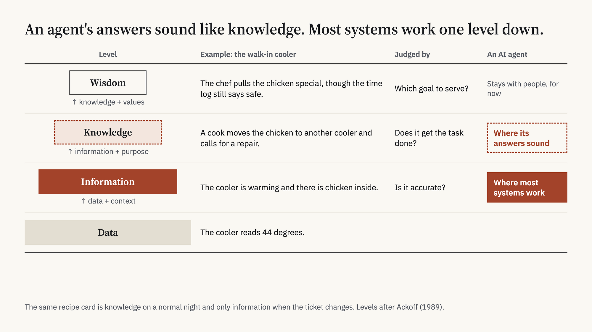
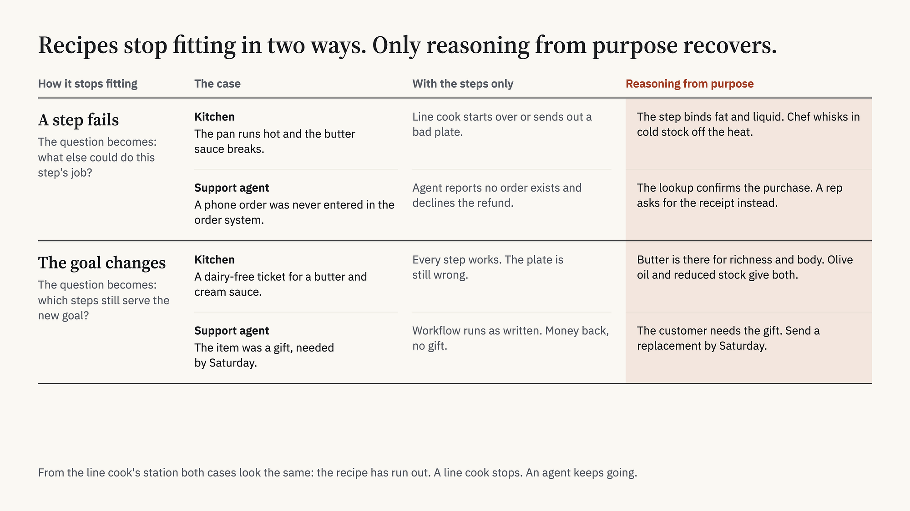
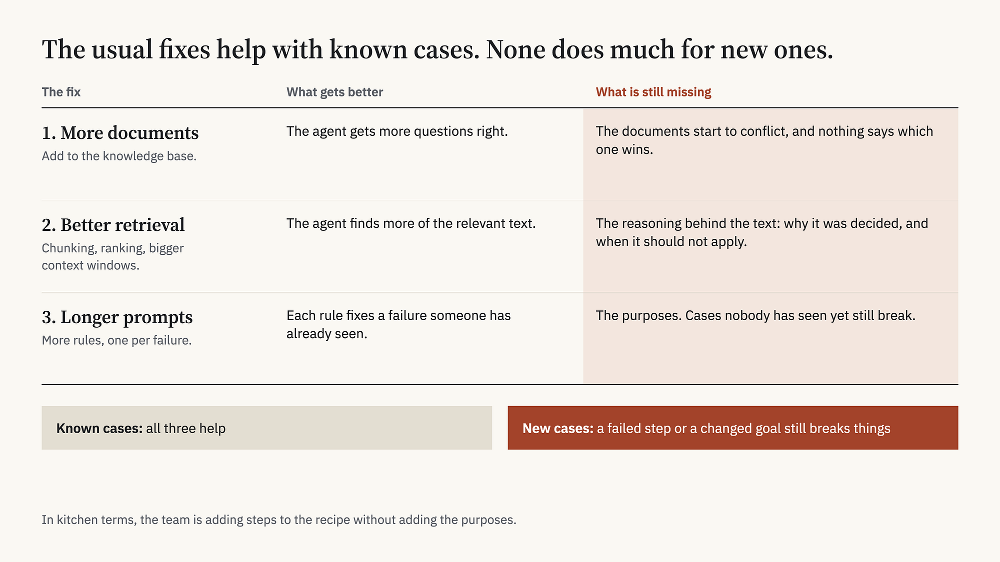
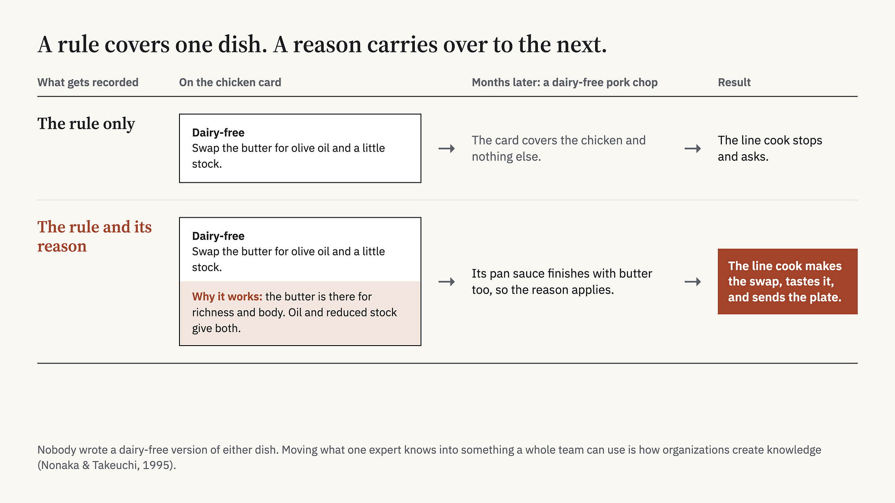

LLMs make agents look easy to build. Many fail because teams treat knowledge as something to retrieve, when people have to make it.

## A ticket the recipe doesn’t cover

Most AI agents work the way a line cook does. They’re handed recipes, in the form of prompts, workflows, and retrieved documents, and they follow them well. The trouble starts when something comes in that the recipes don’t cover.

In a kitchen, that might be a ticket for the pan-roasted chicken with a note that the guest is allergic to dairy. The sauce is butter and cream, and the recipe card has nothing to say about guests who can’t eat it. A line cook stops and asks. A chef swaps the butter for olive oil and a little stock, tastes the result, and sends out a dairy-free plate.

An agent in that spot does neither. It answers right away, in clean confident prose, and the answer is often wrong in a way anyone with experience would catch.

It’s worth asking where the knowledge in that kitchen is, because I think most teams building agents get the answer wrong.

The recipe is the obvious candidate. It’s written down, it can be stored and retrieved, and it looks like knowledge. But a recipe is a record. A chef once worked out how to make this dish for a typical guest on a typical night, and the card is what was left over. It was knowledge for that task. Against a dairy-free ticket it’s only information: accurate, relevant, and not enough to act on.

The line cook is the second candidate. The line cook does know things, including how to execute each step and when to stop. But the line cook doesn’t know what the butter is for, and so can’t get from the card to a plate this guest can eat.

The knowledge that gets the plate out is made on the spot. The chef takes what the card says, applies it to tonight’s goal, and tastes the result. Neither the card nor the line cook had that knowledge beforehand.

That’s the argument of this post. Teams treat their documents as knowledge, so they collect more documents and build better ways to retrieve them. I think documents hold information, and knowledge gets made when someone applies that information to a goal, checks the result, and adjusts. If that’s right, most of the work in building an agent is defining the problem and making the knowledge. Retrieval is a smaller part of the job than it looks.

John Dewey was arguing something very close to this almost a century ago, and I argue his version fits LLM systems better than you’d expect. The rest of the post explains why the retrieval picture is so tempting, uses Dewey to make the case that knowledge is made, and ends with how you should be thinking about it instead.

## The mirage of an easy solution

LLMs make a working system look much closer than it is. You can connect a model to an internal knowledge base in an afternoon, ask it five or six questions, and get good answers to all of them. At that point the project feels nearly done. What’s left looks like adding documents and cleaning up the interface.

It isn’t nearly done. Fluent language looks enough like understanding that the people building the system and the people using it both give it credit for knowledge it doesn’t have. Most of the work sits between that demo and something people can rely on, and plenty of projects never get across.

If capable models really put working systems this close, a lot more of them should be working by now. To explain why they aren’t, I want to start with an old idea about how data turns into wisdom.

## Data, information, knowledge, and wisdom

The DIKW pyramid names four levels and is usually credited to Russell Ackoff. I wrote a whole post on it, [[why-we-have-the-data|Why 'We Have the Data' Is Never the Same as 'We Know What to Do']], so here is the short version. Add context to data and you get information. Add a purpose to information and you get knowledge. Wisdom is knowledge plus values. The pyramid has real problems as a model and I hold it lightly, but the vocabulary earns its keep in this argument.

Take a walk-in cooler that reads 44 degrees. That reading is data. Once you know the cooler is warming and there’s chicken inside, you have information. A cook with knowledge does something with it: moves the chicken to another cooler and calls for a repair. Wisdom shows up when the chef pulls the chicken special for the night even though the time log says the chicken is still inside the safe window, because one sick guest costs more than a night of sales.

LLMs blur these levels. A model holds a huge amount of information, and its answers sound like knowledge. But the model doesn’t know your goals, your customers, your constraints, or why your team made the decisions it made. In most systems it’s working at the information level while sounding like it’s a level up.

There’s a test that separates the two. You judge information by whether it’s accurate. You judge knowledge by whether it gets the task done. An agent can retrieve every relevant document, all of them accurate, and still not know what to do. This is why the same recipe card can be knowledge on a normal night and only information when the ticket changes. Knowledge is relative to the task.

Task-relativity also runs through Rajeev Chhajer’s recent post, [Nobody Knows What “Enough Context” Means](https://medium.com/99p-labs/nobody-knows-what-enough-context-means-2e543fba7e77), which helped prompt this one. He builds a similar vocabulary from the systems side, though we use some of the words a little differently. We start from the same place: relevance is a relationship between information and a task, so a document can’t be relevant in the abstract. Rajeev adds a layer this post skips. He calls it context and argues that it gets assembled fresh for each task rather than stored. He also redraws the pyramid as a loop, where every task produces data that feeds the next one, which fits my argument below that knowledge gets made through feedback. We differ most at the top. Rajeev uses wisdom to mean sufficient context, meaning context that is enough to do the task well and no more. I use it for judgment about which goal to serve, like pulling the chicken special. His open question, how much context is enough, is one I can’t answer yet either.

## Line cooks and chefs

The line cook and the chef differ in a specific way, and it’s worth being precise about it. A line cook follows a recipe. A chef can adjust when the recipe stops fitting the situation.

A recipe is a list of steps that worked under certain conditions. It tells you what to do. It usually doesn’t tell you what each step is for, and it can’t tell you what tonight’s guest needs. While conditions hold, none of that matters, and the line cook turns out the same plate fifty times in a row. I don’t mean that as a knock on line cooks. Consistency is the job, and most of service depends on it.

Recipes stop fitting in two ways.

Sometimes a step fails. The pan runs too hot and the butter sauce breaks into a greasy pool. The recipe says to finish the sauce with butter and goes quiet about what to do when that goes wrong. The line cook can start over or send out a bad plate. The chef knows that step exists to bind fat and liquid into a sauce with some body, so the chef pulls the pan off the heat, whisks in a spoonful of cold stock, and the sauce comes back together.

Other times the goal changes, and the dairy-free ticket is that case. Nothing is wrong with any step. Follow all of them and you get the wrong plate anyway, because the dish now has to do something the person who wrote the recipe never planned for. The chef knows the butter is in there for richness and body, gets both from olive oil and reduced stock, and sends out a plate that’s safe to eat and still tastes like the dish.

In both cases the chef is reasoning from purpose. The chef knows what each step is for, what the dish is for, and what good tastes like. So a failed step turns into a question about what else could do that step’s job, and a changed goal turns into a question about which steps still serve the new one. The line cook has only the steps. From the line cook’s station the two cases look identical: the recipe has run out.

That kind of understanding comes from experience, and I don’t think better recipes can substitute for it. A line cook becomes a chef through years of cooking, tasting, failing, and getting corrected. Michael Polanyi called what results tacit knowledge, and his line about it was that we know more than we can tell. A lot of what a chef knows about why a step exists was learned in one particular kitchen and never written down. My earlier post set tacit knowledge aside to keep the vocabulary simple. In this one it’s the center of the problem.

An agent’s recipes stop fitting in the same two ways.

Picture a support agent with a refund workflow. The workflow says to look up the order in the order system, but this order was placed by phone and never got entered. The agent reports that no order exists and declines the refund. A rep with some experience knows the lookup is there to confirm the purchase, and would ask for the receipt instead.

Or the goal shifts. The customer qualifies for a refund, but the item was a gift, and what they need is a replacement by Saturday. The workflow runs exactly as written. The customer gets their money back and has no gift.

Agents are actually worse off than line cooks in one respect. A good line cook knows where the recipe ends, and stops. An agent has little reliable sense of what it’s missing, which I wrote about in [[the-curation-problem|The Curation Problem]]. So when a step fails or the goal changes, the agent keeps cooking, and it sounds just as sure as before.

## The usual fixes, and why they fall short

The first thing most teams try is more documents. The agent gets more questions right. Then the documents start to conflict with each other, and the agent has no good way to decide which one wins.

So the team works on retrieval: better chunking, better ranking, bigger context windows. Now the agent finds more of the relevant text, but it still doesn’t have the reasoning behind the text. Most organizational documents record what was decided. Very few record why, or when the decision shouldn’t apply.

After that come longer prompts with more rules. Each rule fixes a failure someone has already seen, and the agent keeps failing on cases nobody has seen yet. In kitchen terms, the team is adding steps to the recipe without adding the purposes, so a failed step or a changed goal still breaks things.

All of these help with known cases. None of them does much for new ones.

## The two real causes

Ask an expert why an agent’s answer was wrong and watch what they do. They rarely look anything up. They reason through the case, weigh rules that pull against each other, think about what the person needs, and land on an answer. Often that answer didn’t exist anywhere until they worked it out.

I see two causes behind most failing LLM systems.

The first is the one in the title. Teams confuse information with knowledge. Documents hold information, the way the recipe card does, and so do model outputs. To get knowledge, someone has to apply that information to a specific goal and check the result against reality. If retrieval is all a system does, it stays at the information level however good the retrieval gets.

The second is that teams don’t understand the problem they’re solving. LLMs have made building so cheap that teams start before they can say what decision the system supports, who will use it, or what a good answer looks like.

Each cause makes the other worse. A team without a clear problem can’t tell which information matters, and so it can’t make the knowledge the system needs.

## What Dewey saw

John Dewey gives the clearest account I know of why knowledge is made. He rejected what he called the spectator theory of knowledge, which is the idea that knowing means passively observing a world that’s already there. For Dewey, knowing is something you do. You act on a situation, watch what happens, and revise your understanding.

Larry Hickman’s book *John Dewey’s Pragmatic Technology* takes this further. Hickman shows that Dewey thought of this activity as a kind of technology, and that he used the word broadly, for work with tools and techniques of any kind. Hammers and machines are tools. So are ideas, hypotheses, and language. On Hickman’s reading, inquiry is itself a technology and knowledge is what it produces, in roughly the way a carpenter’s tools produce a table.

That changes how I think about LLMs. In Dewey’s terms a model is a tool for inquiry. It can supply information, suggest possibilities, and draft responses, and all of that helps inquiry along. But knowledge only appears when someone takes what the model offers, applies it to a real situation, and judges how it turned out. A team that treats the model as a warehouse of finished knowledge has misread what kind of tool it has, and that mistake gets built into the system.

Dewey also explains why the problem has to come first. He described inquiry as starting from an unsettled situation, where something feels wrong and nobody can yet say what the problem is. The first job is turning that vague sense of trouble into a clear question. He liked the old saying that a problem well put is half solved. Teams that start building an agent before they’ve stated the problem are skipping the step that points everything else in a direction.

## The strongest objection

The best objection I know goes like this. Models train on a large share of the public web, context windows keep growing, and retrieval keeps getting better, so maybe the gap closes without any of this effort.

For common, well-documented tasks I think that’s already true. Retrieval works there, and a line cook is all you need.

What a better model can’t do is define your problem for you. It also can’t supply knowledge about your customers, your constraints, and your goals, because that knowledge doesn’t exist until people in your situation make it.

## Breaking problems down and choosing which ones to solve

If knowledge is made, then the skills that matter most for people building these systems are breaking problems down and choosing which ones to solve. The kitchen has both. The line cook works one ticket at a time, and the chef does two kinds of work the line cook rarely sees.

One is prep. Before service starts, the chef splits each dish into components and prep steps, so that a complicated plate becomes a list of small tasks, each with clear inputs and a clear standard for done. The equivalent in AI system design is splitting a broad goal into smaller problems, where each one has a decision it supports, the inputs it needs, and a test for a good result.

The other is the menu. The chef decides what goes on it, and a good chef will cut a dish the kitchen can’t make reliably even if guests would order it. For an AI system, that means deciding which problems an agent should handle and which it shouldn’t. Sometimes the reason is that the knowledge doesn’t exist yet. Sometimes it’s that a wrong answer costs too much.

LLMs have made both skills worth more. Building got cheap, so teams can now build the wrong thing faster than ever, and the hard part has moved to choosing and shaping the problem. Understanding a problem is knowledge too, and it gets made the usual way: by talking with users, running experiments, and studying failures. In [[what-do-we-mean-by-learning|What Do We Mean by Learning?]] I call those discovery and framing.

## What to build instead

If you accept that knowledge is made, a few habits follow.

**Write the problem definition first.** Name the decision the system supports, who uses it, and how you’ll judge a good answer. Do this before you connect any data.

**Capture the reasoning, and the decision with it.** When an expert makes a call, record why, when it applies, and who made it. Do the same for workflow steps by writing down what each step is for. That gives an agent something to work from when a step fails or the next case is a little different from the last.

**Build feedback loops from day one.** Evaluations, user corrections, and expert review are how agent outputs turn into tested knowledge over time. It’s the same thing that happens when a chef tastes a line cook’s sauce and corrects it.

**Manage knowledge over its whole life.** Version it so the system knows which guidance is current. Mark its scope and confidence so the agent can tell when it applies. Review it on a schedule, because stale guidance wins quietly if nobody is looking.

**Keep people where judgment lives.** Experts make and correct the knowledge, and agents apply it at a scale no expert could reach alone. This costs experts’ time. I think that’s cheap compared with a system that fails without anyone noticing.

## The open question of wisdom

I’m much less sure about the top of the pyramid.

Wisdom is judgment about which goal to serve, and it often means overriding a recipe that technically applies. I want to keep that separate from adjusting to a changed goal. On the dairy-free ticket the guest set the new goal and the chef found a way to meet it, which is knowledge. Wisdom is choosing the goal in the first place.

The chef who pulls the chicken special despite a passing temperature log is showing wisdom, and I haven’t seen an agent do anything like that reliably. For now my view is that wisdom stays with people. I hold that loosely, and there are a few questions I’d like to hear other people’s thinking on:

- Can a system make knowledge without a person in the loop?
- How would you know an agent has moved from line cook to chef?
- Who owns the knowledge an agent helps make?

## Back in the kitchen

Go back to the dairy-free ticket. Suppose the chef explains the swap to the line cook, and the next morning someone adds it to the recipe card, along with the reason it works.

Months later a dairy-free ticket comes in for the pork chop. Nobody ever wrote a dairy-free version of that dish either, but its pan sauce finishes with butter too. This time the line cook doesn’t stop. The line cook applies the reason from the chicken card to the pork chop sauce, tastes it, and sends the plate out.

If the card had only gained a new rule, it would have covered the chicken and nothing else. Because the reason was written down, it carried over to a dish nobody had planned for. Nonaka and Takeuchi describe this move, from what one expert knows to something a whole team can use, as how organizations create knowledge.

I think AI systems can go the same way. An agent that failed on an unfamiliar case can get the next one right, provided a team has defined the problem, made the knowledge the system needs, and recorded it with its reasons somewhere the agent can use it. That is slower than the afternoon demo suggests, and it’s most of the job.

## Closing thoughts

If knowledge has to be made, then no model upgrade will hand a team the knowledge its agent needs. I read that as a scoping instruction. The practical program is to pick the problems where a team can state the decision, make the knowledge, and test it, build agents for those, and be honest about the cases that still need a person. Teams have spent a few years collecting recipes and building faster ways to find them. My bet is that the cooking is now the problem.

If you’re building with LLMs, here’s one exercise for this week. Pick a system and write down, in a few sentences, the decision it supports and how you’d judge a good answer. If you find those sentences hard to write, the system has a problem that better retrieval won’t fix.

## References

Ackoff, R. L. (1989). From data to wisdom. *Journal of Applied Systems Analysis*, 16, 3–9.

Dewey, J. (1929). *The Quest for Certainty.* Minton, Balch.

Dewey, J. (1938). *Logic: The Theory of Inquiry.* Henry Holt.

Hickman, L. A. (1990). *John Dewey’s Pragmatic Technology.* Indiana University Press.

Nonaka, I., & Takeuchi, H. (1995). *The Knowledge-Creating Company.* Oxford University Press.

Polanyi, M. (1966). *The Tacit Dimension.* Doubleday.

*Originally published on the [99P Labs blog](https://medium.com/99p-labs/why-many-ai-agents-fail-0ac558ffa7b7) on 2026-11-11.*

## See also

- [[why-we-have-the-data|Why 'We Have the Data' Is Never the Same as 'We Know What to Do']]
- [[the-curation-problem|The Curation Problem]]
- [[what-do-we-mean-by-learning|What Do We Mean by Learning?]]
