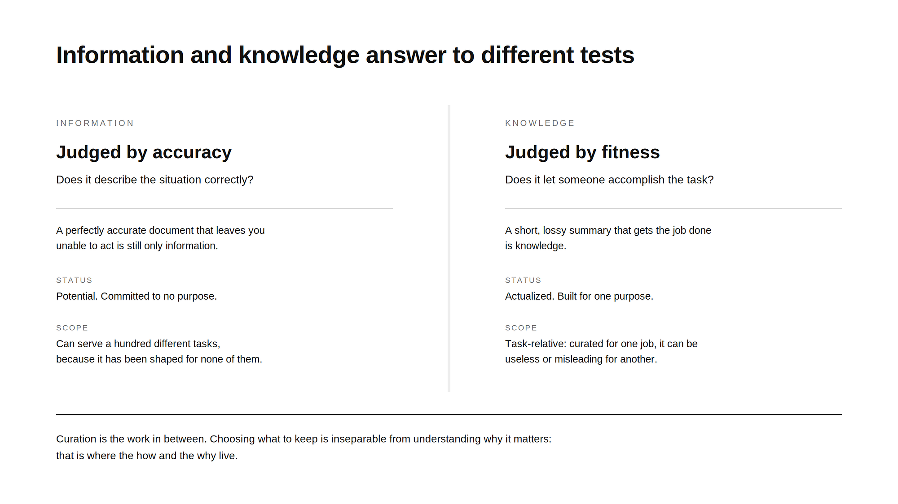
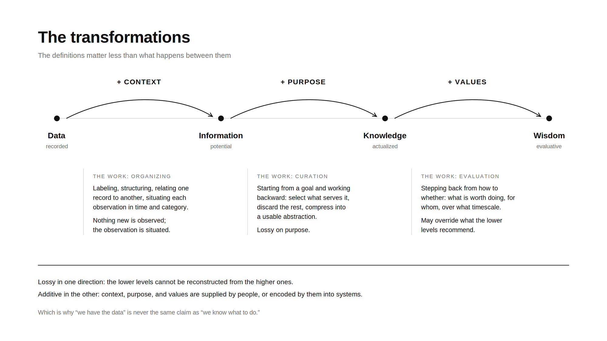
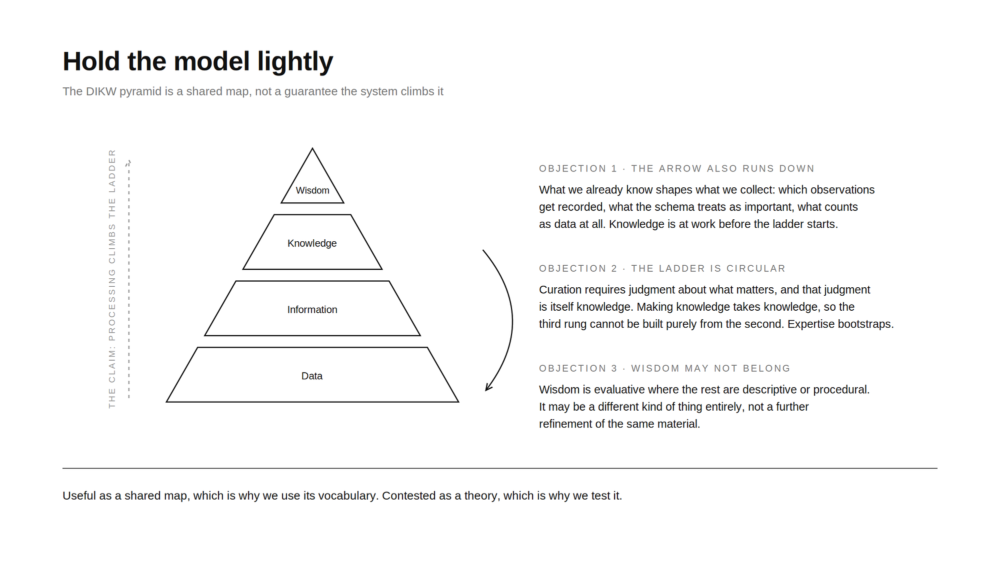

When teams build information systems, they often talk past each other about what they mean by “data,” “information,” and “knowledge.” The DIKW pyramid offers a shared vocabulary, but it’s frequently treated as a neat, automatic progression: more processing yields the next level up. In practice, each transformation requires deliberate human work, adding context, purpose, and values that don’t exist in the layer below. In this post, we lay out working definitions for each level, show what transformations actually require, and explain why holding the model lightly matters for building systems that help people act.

> **A note on scope:** This framework is scoped to systems that use data, dashboards, databases, AI agents, and similar artifacts. It’s not meant to be exhaustive or to capture all forms of human knowing. Knowing how to ride a bike, read a room, or improvise a jazz solo obviously doesn’t fit this model, and we’re deliberately leaving that kind of embodied, tacit knowledge outside the vocabulary.

## The Four Levels

### Data: Raw Observations

**Data is raw symbols or recorded observations, treated as simply “there.”** It sits at the bottom: marks, numbers, readings, log entries, checkboxes, characters in a field. It carries no built-in meaning. A spreadsheet cell containing 42 tells you nothing until you know what was measured, by whom, in what units, and why. The Latin *datum* means “that which is given,” and the word carries a quiet lie. Nothing is purely given. Before anything exists as data, a person (or a system a person designed) had to notice something, decide it was worth recording, choose a format, and write it down. Every dataset is the residue of human choices about what counts. This matters because when someone says “the data shows,” we are already downstream of decisions about what to capture and what to ignore.

**Example:** A server writes “T4 salmon” on a pad. That string of marks is data. Alone, it means almost nothing. A stranger finding the pad on the sidewalk could not act on it.

### Information: Data Plus Context

**Information is data given context, structure, and relevance so it answers basic questions: who, what, where, when.** It is data organized enough to reduce someone’s uncertainty. The raw marks remain, but they have been connected to time, place, categories, and constraints so a person encountering them knows what situation they describe. One useful lens: information doesn’t only live in the document or the database. It also lives in what remains in a person’s mind after they encounter something. Two people can read the same ticket and walk away with different information because interpretation does part of the assembly. The object carries the potential; the reader completes the circuit. Information is potential. It describes a situation accurately but is not yet committed to any purpose. The same information can serve a hundred different tasks, which is another way of saying it has not yet been shaped for any of them.

**Example:** The kitchen ticket now reads “Table 4, salmon, medium-rare, no sauce, fire at 7:42.” The same order has become information because time, place, and constraints have been added. Anyone in the kitchen now knows what is being asked for.

### Knowledge: Information Plus Purpose

**Knowledge is information curated to accomplish a specific task.** If information is potential, knowledge is that potential actualized. Someone takes a body of information, selects what matters for a particular goal, discards the rest, and compresses the remainder into a form built for action: a cheatsheet, a checklist, a decision rule, a runbook, a mental model. The synthesized abstraction is the knowledge. Its defining feature is not how much it contains but how directly it can be used. This gives knowledge a test that information does not have. Information is judged by accuracy: does it describe the situation correctly? Knowledge is judged by fitness: does it let someone accomplish the task? A perfectly accurate document that leaves you unable to act is information. A short, lossy summary that gets the job done is knowledge. Curation is the work in between, and it is real work: choosing what to keep is inseparable from understanding why it matters. Two properties follow:

- **Knowledge is made, not found.** Someone has to do the selecting, testing, and compressing, and the result improves through use and correction.
- **Knowledge is task-relative.** The same information curated for a different task yields different knowledge, and a cheatsheet built for one job can be useless or misleading for another.

Two honest caveats. This definition is circular in a way worth owning: curating information requires judgment about what matters for the task, and that judgment is itself knowledge. Making knowledge takes knowledge, which means the ladder cannot be a pure bottom-up production process; expertise bootstraps. And the definition is scoped: it covers knowledge as an artifact, which is the right frame for people who build information systems, not a theory of all knowing. Knowing how to ride a bike or read a room is not curated information in any natural sense, and we are deliberately leaving that kind of knowing outside the vocabulary.

**Example:** Over years of Friday services, the chef has compressed a mass of experience into two standing rules: this supplier’s fish runs soft on Fridays, and Table 4 complains if the center is above 125 °F. That is a cheatsheet, whether it hangs on the station wall or lives in the chef’s head. Tonight it meets two pieces of fresh information: the ticket, and a grill reading 20 degrees hot. The rules applied to the readings yield exact timing and finish. The information describes tonight; the knowledge decides what to do about it. Neither alone could cook the fish.

*Information is judged by accuracy. Knowledge is judged by fitness for the task.*

### Wisdom: Knowledge Plus Values

**Wisdom is the capacity to judge which goals are worth pursuing, and to act well when the situation is uncertain or incomplete.** Everything below this level serves a task: data records, information describes, knowledge tells you how to succeed at a goal already chosen. Wisdom is evaluative. It asks whether the goal is worth pursuing at all, whether the thing you can do is the thing you should do, and it operates precisely where data, information, and knowledge run out: incomplete facts, competing values, long time horizons, consequences that cannot be measured tonight. Wisdom often looks like restraint, or like trading a visible short-term win for something harder to see. It weighs interests beyond the immediate actor’s. A caution: critics question whether wisdom really sits cleanly above knowledge in a hierarchy at all. It may be a different kind of thing entirely, not a further refinement of the same material.

**Example:** The owner looks at the full night’s numbers, the short staff, and the restaurant’s long-term reputation, then decides not to push the high-margin special even though the data, information, and knowledge all say it would sell. The choice protects something larger than tonight’s covers.

*Each step adds something the level below does not contain. That addition is deliberate work.*

## The Transformations: Where the Work Happens

The definitions matter less than what happens between them. The whole ladder compresses to one line:

> **Data plus context is information. Information plus purpose is knowledge. Knowledge plus values is wisdom.** Each move up adds something the level below does not contain, and each addition is work someone has to do. It never happens automatically.

### Data → Information: Adding Context and Structure

Someone connects raw symbols to time, place, category, and purpose. The work is organizing: labeling, formatting, relating one record to another, deciding what a reader needs to know for the marks to make sense. “T4 salmon” becomes “Table 4, salmon, medium-rare, no sauce, fire at 7:42.” Nothing new was observed; the existing observation was situated.

### Information → Knowledge: Adding Curation Toward a Task

Someone starts from a goal and works backward: selecting the information that serves it, discarding what does not, and compressing what remains into a usable abstraction. The work is synthesis under a purpose, and unlike the first transformation it is lossy on purpose. Throwing information away is the point; what survives is exactly what the task needs. The chef’s years of tickets, complaints, and Friday deliveries become two rules that, combined with tonight’s readings, decide the timing.

### Knowledge → Wisdom: Adding Values and Long Horizons

Someone steps back from “what can I do and how” to “what is worth doing, and for whom, over what timescale.” The work is evaluation under uncertainty. It often means overriding what the lower levels recommend, as the owner does when declining the profitable special. Two things to notice:

- **Each transformation is lossy in one direction and additive in the other.** You cannot reconstruct the full record of Friday services from the chef’s two rules, and you cannot derive the owner’s values from the sales figures.
- **The additions come from people.** Context, purpose, and values are supplied by humans (or encoded by them into systems), which is why “we have the data” is never the same claim as “we know what to do.”

### Information Architecture: Design for Comprehension

**Information architecture is the deliberate arrangement of parts so the whole becomes understandable.** It is design work aimed at someone else’s comprehension. It covers how content is structured, what things are called, how labels stay consistent, and how a person (or a system) finds their way through a body of material. When AI is involved, it extends to schemas, ontologies, metadata, and how a corpus is organized, because a model’s grasp of a domain depends on how the domain was arranged for it. The test of information architecture is never elegance for its own sake. It is whether the intended audience can find, understand, and act on what they need.

**Example:** The menu groups dishes by course and uses consistent names so diners can choose quickly. The POS system uses the same labels, so servers and kitchen never misread an order. Same facts, arranged for two different audiences.

## DIKW: Hold the Model Lightly

*The DIKW pyramid is a useful shared map, but the claim that processing automatically climbs it does not hold.*

DIKW is the claimed ladder that turns data into information into knowledge into wisdom, each step produced by processing the one below. It is the standard pyramid diagram: data at the base, wisdom at the peak, with the implication that enough processing at each level yields the next. It is useful as a shared map, which is why we use its vocabulary. It is also contested. Whether those transformations actually occur, whether they run only in that direction (knowledge shapes what we collect as data in the first place), and whether wisdom belongs on the ladder at all remain open questions. Our own definition of knowledge already supplies one crack: curation requires knowledge, so the third rung cannot be built purely from the second. Hold the model lightly.

## Why This Matters for AI Systems

This framework matters for building AI systems because it clarifies where models help and where human judgment remains essential:

- **Models excel at data → information transformations.** They can organize, label, and structure raw observations at scale.
- **Models assist with information → knowledge, but require human curation.** They can synthesize and compress, but the purpose and task definition must come from people.
- **Wisdom remains fundamentally human.** Evaluating which goals are worth pursuing, especially under uncertainty and competing values, is not a processing problem.

When teams conflate these levels, they overestimate what automation can do and underestimate the work required to make information actionable. The DIKW vocabulary helps separate what the system can provide from what people must supply: context, purpose, and values.

## Getting Started

If you’re building information systems or AI agents, try this:

1. **Audit your artifacts.** Label each document, dashboard, or model output as data, information, or knowledge. Be honest about what’s missing.
2. **Identify the transformations.** For each level, ask: what context, purpose, or values need to be added to move up? Who supplies them?
3. **Design for the work.** Don’t assume transformations happen automatically. Build workflows, tools, and ownership that make the required curation explicit.

The DIKW pyramid is not a recipe. It’s a map, one that helps teams see where the real work lives and design systems that support it.

## Closing thoughts

The DIKW ladder is useful as a shared map, but the general problem of automatically ascending its levels has no solution. That is not cause for pessimism. It is a scoping instruction. The practical program is to identify which restricted versions of the transformations are tractable, support those deliberately, and remain honest about where human judgment must still intervene. Teams have spent years building better data pipelines and models. Our bet is that the work of adding context, purpose, and values is now the problem.

*Originally published on the [99P Labs blog](https://medium.com/99p-labs/why-we-have-the-data-is-never-the-same-as-we-know-what-to-do-a95f36b8ef21) on 2026-08-24.*

## See also

- [[the-curation-problem|The Curation Problem]]
- [[you-are-not-using-ai-enough|You Are Not Using AI Enough]]
- [[what-do-we-mean-by-learning|What Do We Mean by Learning?]]
