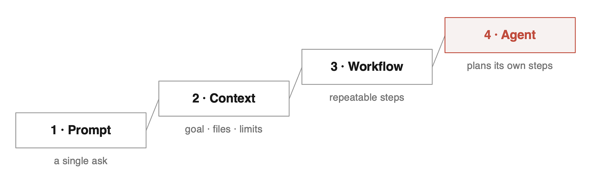
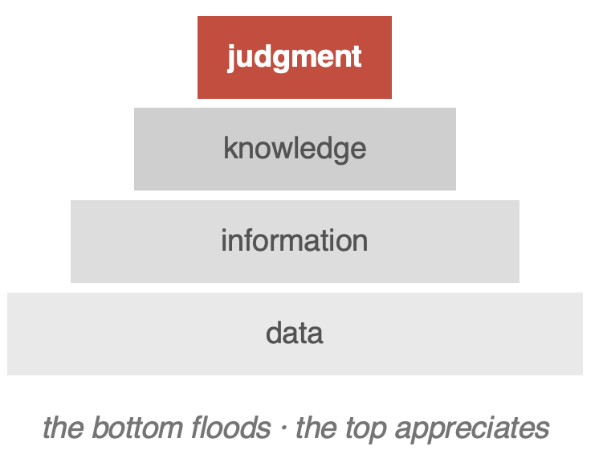

## A Conversation at Smith

We spent a day at Smith College recently to kick off this year’s capstone projects. The teams are just getting started, so the visit was mostly introductions. We meeting the students, meeting the faculty who advise them, walking through the problems they will be working on, and talking about how we can keep growing student innovation together.

These visits matter to us. At 99P Labs we work alongside students and faculty in software engineering, applied AI, systems, human-AI teaming, materials science, and energy systems. The point is not to sponsor projects and check in twice a year. It is to give students more chances to work on real problems and try new approaches.

While we were on campus, we were also invited to talk with students and faculty about AI and how it is changing the way we work, learn, and build things. We called the talk “You Are Not Using AI Enough.”

The title was meant to provoke, and it did. But the argument behind it is not that students should hand more of their work to a chatbot. It is that most people are still using AI at the very bottom of what it can do.

## From vending machine to engineering tool

The easiest way to use AI is to treat it like a vending machine. Put in a prompt, take the answer, move on. That is useful, and it is the first rung of a much taller ladder.

We described four levels:

1. **Prompt:** a single ask
2. **Context:** giving AI the goal, files, constraints, and information it needs
3. **Workflow:** building repeatable steps for a task
4. **Agent:** letting AI help plan and execute its own steps toward a goal

Climbing the ladder means moving from asking AI questions to designing how you work with it. That takes judgment, something AI cannot take off your hands.

The loop we teach the students to try is simple. Make a move. See what AI does with it. Judge the result. Make the next move. The answer is not the important part. What you do with the answer is.

## A Smith project put the idea to the test

We used a Smith project to make this concrete. The task was to design a small wind turbine.

The first team worked on it for a full year with minimal AI use. They developed more than 200 concepts, spent a semester on research, built prototypes, ran wind-tunnel tests and wake studies, and finally worked through the economics of the design. The economics were not kind. Breakeven came out to roughly 5,000 years.

A second team took on the same general problem over eight weeks, with AI playing a much larger role. They generated 63 designs and narrowed them to two in a single afternoon. They built an LLM-based wiki that helps with the evaluations. They worked through computational fluid dynamics without anyone on the team having a background in it.

Both teams did excellent work. The difference was not in the quality of the effort but in how much ground each was able to cover in the time they had. That difference drew some pointed questions from the room, and they were worth hearing.

## Was it really an experiment?

We had described the two projects as an experiment. A faculty member pushed back on that, and the pushback was fair.

This was not a controlled study. Different students, different circumstances, no attempt to hold variables constant or measure learning outcomes rigorously. The second team also had access to the first team’s results, even though the two groups never worked together. If we ran this again, we would think much harder about what the second team gets to see.

So we were not presenting proof that AI makes students better or worse. We were sharing an experience that raised a question worth sitting with. What happens when you put a powerful AI capability in the hands of students working on a hard problem?

That question opened onto harder ones. Did AI accelerate learning, or mostly accelerate output? How much did the first team’s year of immersion build understanding and judgment that the second team never had to develop? What happens when AI gets a student to an 80 percent solution fast, but the last 20 percent still demands real expertise? And what happens to expertise itself when some of the struggle that used to come with learning a subject disappears?

We do not have settled answers. But the conversation was better for the challenge.

## AI collapsed the front end. It did not compress the physics.

One thing did come through clearly from the project.

The AI-supported team could explore ideas, research unfamiliar topics, generate designs, and get moving far faster than the first team. Getting started became dramatically easier. But when they reached the hard parts, they still needed people who understood the physics. Getting all the way to a sound solution stayed hard.

That distinction matters. AI changes the economics of exploring an idea. It lowers the cost of learning about a new subject, testing a direction, or generating candidate approaches. It does not remove the need to understand the problem. In some cases it makes understanding the problem more important, because you arrive at the difficult part sooner and with less scaffolding.

## The questions went well beyond productivity

Students and faculty did not stay on the wind turbine for long. We talked about bias, intellectual property, security, governance, accountability, agents, and what early-career work looks like when the routine parts are automated.

We talked about whether students need a foundation of knowledge before leaning heavily on AI. We talked about what people should do with the time AI gives back. One idea kept surfacing. Productivity should not just mean doing more of the same work faster. If AI takes some work off the plate, the opportunity is to spend that time on deeper thinking, creativity, exploration, and relationships.

We also talked about what happens as AI systems become more capable and more autonomous. Our position was simple. The responsibility does not move to the AI. An agent can execute the work. It cannot own the consequences. That makes evaluation, guardrails, and human judgment more important, not less.

## This worry is not new

Some of the concern in the room was familiar, and it should be. Every technology that makes information cheap has set off the same alarm. When writing spread, people worried it would weaken memory and make thinking lazy. When calculators reached classrooms, people worried students would never learn arithmetic. The concern was reasonable each time, and each time the fear pointed at the wrong thing.

Writing did make memory cheap. Thinkers became more valuable. Calculators did make arithmetic cheap. Mathematicians became more valuable. The skill that got automated lost its price. The skill that sat above it gained one.

We are living through the same shift with AI. That does not make the questions about learning and expertise go away. It does suggest that the way through is the one that worked before. Figure out what the new tool makes cheap, and put your effort into what it makes valuable.

## What should students do with this?

For us, this ties straight back to student innovation.

AI should not be a shortcut we reluctantly tolerate. It is a capability students should be encouraged to explore, with the goal of going further, not just faster. Students should test how far up the ladder they can climb. They should learn what works, record what fails, and share the failures with each other.

A failed approach is not wasted effort. It can become the evaluation set for the next attempt. That is the philosophy behind 99P Labs. We run “experiments” knowing most of them will fail, because the failure is what teaches us how to make the next one better.

## Automate the work. Never the responsibility.

We closed with what we call our Ten Commandments of AI Use.

1. Treat every answer as a claim.
2. Accept nothing you would not accept from a stranger with no sources.
3. Do not worship the first answer. Ask for two more.
4. Judge the claim, not the polish.
5. Make AI argue against you.
6. Ask what would prove it wrong.
7. Make your move first.
8. Give context before casting blame. Most bad output is a briefing problem.
9. Keep a record of failures. Failures are your evaluation set.
10. Own everything you ship. Automate the work. Never the responsibility.

## This is an amazing time

That last one may be the most important, and it points at why we are optimistic.

AI is making information cheap. What appreciates is judgment. Think of it as a stack: data at the bottom, then information, then knowledge, then judgment at the top. AI floods the bottom of that stack. It does not touch the top. If anything, it raises the price of what sits there.

Humans will not be replaced. The right kind of human skills become more valuable. The work of deciding what matters, what to trust, what to build, and what to own does not get automated. It gets more important as everything beneath it gets easier.

The opportunity for students is not to use AI more. It is to use it more seriously. Move beyond the vending machine. Make the first move yourself. Question what comes back. Learn from what fails. Take responsibility for what you build.

Now go make something and see what it does with what you just did.

Use it boldly. Question it relentlessly.

*Originally published on the [99P Labs blog](https://medium.com/99p-labs/you-are-not-using-ai-enough-4783794241c8) on 2026-09-18.*

## See also

- [[why-we-have-the-data|Why 'We Have the Data' Is Never the Same as 'We Know What to Do']]
- [[the-curation-problem|The Curation Problem]]
- [[learning-through-uncertainty|Learning Through Uncertainty]]
